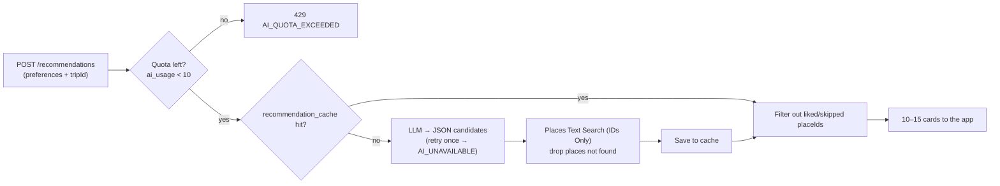

# App Spec: RANSEL (KMP + Ktor)

Oct 12, 2026 · @SEN

## Summary

A trip management app: plan the itinerary, the packing list, and expenses in one place, running on Android, iOS, and Web from one Kotlin codebase. It starts as a tool for solo travellers; shared trips arrive in Phase 4 and AI recommendations in Phase 5.

The project has two goals at once:

- Personal use: replace travel notes scattered across Notes, spreadsheets, and chats.
- End-to-end learning: Compose Multiplatform on the client, and building a backend from scratch with Ktor (setup, database, auth, deploy).

Development principle: every phase produces an app that can be used, not something half-built. Multi-member and AI features are deliberately last, after the foundation is stable. Product requirements are in PRD — RANSEL and implementation details in TRD — RANSEL.

## Tech stack

Everything is written in Kotlin, so data models and validation can be shared between app and server through the `shared` module.

| Layer | Choice | Notes |
| --- | --- | --- |
| UI | Compose Multiplatform | Android, iOS, Web (Wasm) |
| Navigation | Navigation Compose (multiplatform) | Close to what is familiar on Android |
| State | ViewModel + StateFlow | Lifecycle ViewModel is already multiplatform |
| DI | Koin | Mature KMP support, light setup |
| Local database | Room 3 (androidx.room3), Android and iOS only | Familiar from Android and stable on KMP; the web app is online-only and has no local database |
| Networking | Ktor Client + kotlinx.serialization | Different engine per platform via expect/actual |
| Dates and money | kotlinx-datetime, `Long` in minor units | Avoid `Double` for amounts |
| Backend | Ktor Server | Routing, JWT auth, StatusPages for errors |
| Server database | PostgreSQL + Exposed | Schema migrations with Flyway |
| Infrastructure | Docker Compose | Local Postgres in development, server image for deploy |
| AI (Phase 5) | LLM API called from the server + Places API | API keys are never in the client |

Library versions change quickly; check the latest stable versions in the JetBrains docs and the [kmp.jetbrains.com](https://kmp.jetbrains.com) template at setup.

## Roadmap

Five phases, each ending with an app that can be used. Phase 1 is already useful for a real trip without any server.

### Phase 1 — Offline app (solo)

- Features: trip list; itinerary per day (add, edit, reorder); packing list per category; record expenses (amount, currency, category, date) and a summary against the budget.
- Learning: KMP project structure, commonMain vs platform source sets, expect/actual, local database, Compose Multiplatform on Android and iOS (web joins in Phase 2, once there is an API to talk to).
- Done when: one real trip can be planned from start to finish on a phone.

### Phase 2 — Basic backend

- Features: a Ktor server with CRUD for trips, itinerary, packing, and expenses; no sign-in yet (one dummy user).
- Learning: Ktor project setup, routing, serialization, Postgres in Docker, Flyway migrations, Exposed, StatusPages for errors, request validation, testing the API with .http files or Postman, unit tests with testApplication.
- Done when: every endpoint can be tested and its data is stored in Postgres.

### Phase 3 — Auth and sync

- Features: sign up / sign in, forgot password, and trips synced between your own phone and web.
- Learning: password hashing (bcrypt), JWT access + refresh tokens, the Ktor Authentication plugin, an offline-first sync strategy (updatedAt, soft delete, last-write-wins), the first cloud deploy.
- Done when: a trip created offline on a phone shows up on the web once online.

### Phase 4 — Multi-member

- Features: invite friends by link or code, owner/editor/viewer roles, who paid for each expense, split bill, and a "who owes whom" summary with mark as settled.
- Extra feature: packing templates, both built-in (beach, city trip, mountain hike) and saved from earlier trips, with a preview and an option to skip items already on the list.
- Learning: many-to-many relations, per-resource authorization, concurrent edit conflicts, optionally WebSocket for realtime updates.
- Done when: two accounts can manage one trip and the split bill result is correct.

### Phase 5 — AI recommendations (Explore)

- Features: an Explore screen to fill in the destination and preferences; the AI returns food, attraction, and sightseeing recommendations picked by swiping; swipe right saves the place to Unscheduled in the itinerary.
- Learning: calling an LLM from the server, structured output (JSON), grounding with the Places API, caching, rate limiting, cost control.
- Done when: recommendations are relevant, the places are real (validated), and they can be scheduled into the itinerary.

Phase 5 design details are in the **AI recommendations** section.

## Data model

Every table uses a client-generated UUID plus `created_at`, `updated_at`, and `deleted_at` (soft delete). These three columns make the Phase 3 offline-first sync possible. The SQL is in `db/migration` as V1–V4 (one file per phase); each table below exists in those files as written.

| Table | Main columns | Migration (phase) |
| --- | --- | --- |
| trips | id, owner\_id, title, destination, start\_date, end\_date, base\_currency, budget\_minor, cover\_url | V1 (1–2) |
| itinerary\_items | id, trip\_id, day\_date (null = unscheduled), start\_time, end\_time, title, category, place\_name, place\_id, lat, lng, duration\_min (AI estimate), notes, booking\_url, source (MANUAL/AI), sort\_order | V1 (1–2) |
| packing\_items | id, trip\_id, category, name, quantity, is\_packed, sort\_order | V1 (1–2) |
| packing\_templates | id, owner\_id (null = built-in), name, items JSONB; shared\_trip\_id added in V3 | V1, V3 |
| expenses | id, trip\_id, amount\_minor, currency, fx\_rate\_to\_base, category, payment\_method, note, spent\_at, paid\_by\_user\_id | V1 (1–2) |
| users | id, display\_name; email, password\_hash, default\_currency added in V2 | V1, V2 |
| refresh\_tokens | id, user\_id, token\_hash, device\_name, expires\_at, revoked\_at | V2 (3) |
| password\_reset\_tokens | id, user\_id, token\_hash, expires\_at, used\_at | V2 (3) |
| trip\_members | trip\_id, user\_id, role (OWNER/EDITOR/VIEWER), joined\_at | V3 (4) |
| trip\_invites | code, trip\_id, created\_by, role, max\_uses, used\_count, expires\_at, revoked\_at | V3 (4) |
| expense\_splits | expense\_id, user\_id, share\_minor | V3 (4) |
| settlements | id, trip\_id, from\_user\_id, to\_user\_id, amount\_minor, settled\_at | V3 (4) |
| recommendation\_cache | query\_hash, destination, response JSONB, model, hit\_count, expires\_at | V4 (5) |
| recommendation\_feedback | trip\_id, user\_id, place\_id, place\_name, category, action (LIKE/SKIP) | V4 (5) |
| ai\_usage | user\_id, usage\_date, count (10 per day) | V4 (5) |

Design notes:

- Money is stored as a `Long` in the smallest unit (`amount_minor`): Rp50,000 = 50000, USD 12.50 = 1250. This avoids `Double` rounding errors.
- The currency is recorded per expense (`currency`) together with `fx_rate_to_base`, the rate at the time of the expense, so old totals do not change when rates move. `payment_method` holds the "Bayar pakai" field: CASH, DEBIT\_CARD, CREDIT\_CARD, TRANSFER, E\_WALLET, OTHER.
- `sort_order` is a fractional number so a reorder does not have to update every row.
- `category` on itinerary\_items and expenses uses one shared enum (ATTRACTION, FOOD, TRANSPORT, LODGING, SHOPPING, OTHER) with the same color per value. Itinerary labels: Wisata/Explore, Kuliner/Eat, Perjalanan/Travel, Menginap/Stay, Belanja/Shop, Lainnya/Other. Expense labels: Aktivitas/Activities, Makan/Food, Transport, Penginapan/Lodging, Belanja/Shopping, Lainnya/Other.
- In Phase 1, `owner_id` and `paid_by_user_id` may hold a fixed local ID; it is replaced by the real user ID on sign-in in Phase 3.

## API endpoints

The main endpoints are below; the full list (including edit/delete, logout, invite and settlement lists, undo swipe) and the exact request/response classes are in TRD — RANSEL and the shared module. Every endpoint starts with `/api/v1`. From Phase 3, everything except auth must carry the `Authorization: Bearer <access_token>` header.

| Method | Path | Purpose | Phase |
| --- | --- | --- | --- |
| GET | /health | Check that the server is up | 2 |
| GET, POST | /trips | List the user's trips / create a trip | 2 |
| GET, PUT, DELETE | /trips/{id} | Trip detail + summary / update / delete (soft delete) | 2 |
| GET, POST | /trips/{id}/itinerary | List / add activities | 2 |
| PUT, DELETE | /trips/{id}/itinerary/{itemId} | Update (including scheduling) / delete an activity | 2 |
| PUT | /trips/{id}/days/{date}/order | Save the new order and times of one day | 2 |
| GET, POST | /trips/{id}/packing | List / add items | 2 |
| PATCH | /trips/{id}/packing/{itemId} | Tick / update an item | 2 |
| POST | /trips/{id}/packing/uncheck-all | Uncheck all items | 2 |
| GET, POST | /trips/{id}/expenses | List / record expenses | 2 |
| GET | /trips/{id}/expenses/summary | Totals per category and per day | 2 |
| POST | /auth/register, /auth/login, /auth/refresh | Sign up, get access + refresh tokens, refresh the access token | 3 |
| POST | /auth/password/forgot, /auth/password/reset | Forgot password | 3 |
| GET, PATCH | /me | User profile and default currency | 3 |
| GET | /sync?since={timestamp} | Fetch every change since a point in time | 3 |
| POST | /sync | Send local changes (batch) | 3 |
| POST, DELETE | /trips/{id}/invites, /trips/{id}/invites/{code} | Create / revoke an invite code | 4 |
| GET, POST | /invites/{code}, /invites/{code}/accept | Preview / join a trip | 4 |
| GET, PATCH, DELETE | /trips/{id}/members, /trips/{id}/members/{userId} | List members / change role / remove | 4 |
| POST | /trips/{id}/leave, /trips/{id}/transfer-ownership | Leave the trip / transfer ownership | 4 |
| GET | /trips/{id}/balances | Who owes whom | 4 |
| POST | /trips/{id}/settlements | Mark as settled | 4 |
| GET, POST | /packing-templates, /trips/{id}/packing/apply-template | Templates / use a template | 4 |
| POST | /recommendations, /recommendations/feedback | AI recommendations from preferences / LIKE or SKIP | 5 |

### Response format standard

Success or failure is read from the **HTTP status code**, not from a field in the body. The body always takes one of two shapes: `data` on success, `error` on failure.

| Case | Status | Body |
| --- | --- | --- |
| Get one resource | 200 | `{"data": {...}}` |
| Get a list | 200 | `{"data": [...], "meta": {"page": 1, "pageSize": 20, "total": 57}}` |
| Create a resource | 201 | `{"data": {...}}` (the new resource, with its id) |
| Delete / no content | 204 | empty |
| Invalid input | 400 / 422 | `{"error": {...}}` + details per field |
| Not signed in / token expired | 401 | `{"error": {...}}` |
| Not yours | 403 | `{"error": {...}}` |
| Not found | 404 | `{"error": {...}}` |
| Conflict (e.g. email already registered) | 409 | `{"error": {...}}` |
| Quota reached | 429 | `{"error": {...}}` |
| Server error | 500 | `{"error": {...}}`, no stack trace |

Example 200:

```json
{
  "data": {
    "id": "8f1c...",
    "title": "Bali 4 hari",
    "startDate": "2026-11-20",
    "endDate": "2026-11-23",
    "baseCurrency": "IDR",
    "budgetMinor": 5000000,
    "updatedAt": "2026-10-13T05:30:00Z"
  }
}
```

Example error:

```json
{
  "error": {
    "code": "VALIDATION_FAILED",
    "message": "End date must be after the start date",
    "details": { "endDate": "MUST_BE_AFTER_START" }
  }
}
```

Supporting rules:

- Fields use camelCase, dates are ISO 8601 (`2026-11-20`), times are UTC (`...Z`), money is in the smallest unit (`budgetMinor`).
- The error `code` is a fixed constant for app logic (`TRIP_NOT_FOUND`, `TOKEN_EXPIRED`, `INVITE_EXPIRED`, `AI_QUOTA_EXCEEDED`, …); `message` is only for display and may change.
- The wrappers live in `shared`: `ApiResponse<T>(data: T, meta: PageMeta? = null)` and `ApiError(code, message, details)`. The server wraps through a `call.respondData(...)` helper; every error is built in one place through StatusPages.
- In the app, Ktor Client maps responses to `sealed interface ApiResult<T> { Success, Failure }` so ViewModels never touch raw status codes.

## AI recommendations

The user fills in preferences on the Explore screen, the server asks the LLM for recommendations as JSON, and every place is validated against the Places API before it is sent to the app. The LLM is never called from the client.



Similar requests are served from the cache; only new requests cost LLM and Places API calls.

**Inputs on the Explore screen**

- Destination (text field) and dates (a separate field that opens the DateRangePicker); both are filled from the open trip.
- Budget per person per day: Hemat, Sedang, or Bebas (budget, moderate, flexible).
- Interests (multi-select): nature, food, beach, culture, shopping, adventure, nightlife, photo spots.
- Style: Santai or Padat (relaxed or packed).
- Free notes, for example "no pork" or "loves local coffee".

**Example response received by the app**

```json
{
  "groups": [
    {
      "category": "FOOD",
      "items": [
        {
          "name": "...",
          "reason": "Matches your interest in local coffee",
          "priceLevel": 2,
          "suggestedDurationMin": 60,
          "placeId": "...",
          "lat": -8.65,
          "lng": 115.13,
          "rating": 4.6
        }
      ]
    }
  ]
}
```

`category` uses the same enum as the itinerary (ATTRACTION, FOOD, TRANSPORT, LODGING, SHOPPING, OTHER).

**Technical decisions**

- **Structured output:** the prompt asks for JSON that matches the schema, and the server parses it into an `@Serializable` data class in the `shared` module. DeepSeek V4.1 Flash only guarantees "soft" JSON (it does not enforce the schema), so if parsing fails the server retries once and then returns a clear error (`AI_UNAVAILABLE`).
- **Grounding:** the LLM only suggests names and reasons. Whether a place exists is checked against the Places API (Google Places or Foursquare). Places that are not found are dropped, so AI-invented places never reach the user.
- **Cache:** key = hash of destination + interests + budget. Results are kept for a few days in `recommendation_cache`; validated `placeId`s are kept longer.
- **Rate limit:** a daily limit per user with the Ktor RateLimit plugin (`AI_QUOTA_EXCEEDED`): 10 searches per user per day, resetting at 00:00. Explore requires an account; a guest sees a sign-in screen in the Explore tab instead of the form.

### Picking by swipe

Recommendations appear as a Tinder-style card stack: swipe right saves the place, swipe left skips it. Because a swipe has no day or time yet, the place goes to the **Unscheduled** section of the itinerary. From there the user taps **Schedule**, picks a day, and the place is placed at the end of that day (starting when the last activity ends, or 09:00 on an empty day) with the AI's suggested duration.

- Right: create an `itinerary_item` with `day_date = null`, `place_name`, `lat`, `lng`, the suggested duration, and `source = AI`.
- Left: skip, and this place does not appear again in recommendations for the same trip.
- Undo: a button to undo the last swipe, because mis-swipes are common.
- Alternative buttons: ✕ and ♥ under the card, plus arrow keys. On web with a mouse, swiping feels awkward.
- Feedback to the AI: the liked and skipped lists are sent with the next request, so the second batch fits the user's taste better.
- Batch: 10–15 cards per request; when 3 cards are left, the app requests the next batch in the background.
- Session: an unfinished session is kept on the device and shown as a Continue card on the Explore tab.

Data model changes for this: `day_date` in `itinerary_items` becomes nullable, a `source` column (MANUAL/AI) is added, and a new table `recommendation_feedback` (trip\_id, place\_id, action LIKE/SKIP, created\_at).

The Compose implementation fits in `commonMain`: `Modifier.pointerInput` with `detectDragGestures`, a horizontal card offset with `Animatable` (no rotation; an outline plus a SAVE or SKIP label shows the direction), and the card is thrown off screen when the drag passes a threshold, for example 40% of the card width.

### Cost estimate and saving strategy

For personal use the cost is close to zero; the part to watch is the Places API, not the LLM. Prices as of October 2026, subject to change.

| Component | Rate | Per request (15 places) |
| --- | --- | --- |
| DeepSeek V4.1 Flash | $0.15–0.30 input, $0.60–1.20 output per 1M tokens (off-peak/peak) | about $0.003 (1,500 input tokens, 2,000 output) |
| Places Text Search Pro | $32 per 1,000 calls, 5,000 free per month | about $0.48 at 1 call per place |
| Places Text Search IDs Only | Free, unlimited | $0 |
| Place Details Essentials | $5 per 1,000, 10,000 free per month | only for cards that are shown |
| Place Details Pro (rating) | $17 per 1,000, 5,000 free per month | only if ratings are needed |

Saving strategy:

1. Validate existence with IDs Only (free): enough to drop places the LLM invented.
2. Fetch details lazily: photos and ratings only for the top 2–3 cards in the stack. Cards that are never seen cost nothing.
3. Minimal field mask: Google bills by the highest field tier requested, so one rating field can raise the tier.
4. Cache `placeId`s on the server: popular destinations only need validating once.
5. Set a budget alert in the Google Cloud Console from day one.

Sources: [Google Maps Platform pricing](https://developers.google.com/maps/billing-and-pricing/pricing), [Open Places API: Places pricing 2026](https://openplacesapi.com/blog/google-places-api-pricing), [ProPakistani: DeepSeek V4.1 Flash](https://propakistani.pk/2026/09/11/deepseek-v4-1-flash-launches-with-lower-prices-and-native-vision/), [LLM Gateway: DeepSeek V4.1 Flash](https://llmgateway.io/models/deepseek-v4.1-flash).

**Future work:** the AI drafts a daily itinerary from the chosen places, ordering visits by distance and opening hours.

## Project folder structure

One Gradle repository with three modules: `composeApp` (UI for every platform), `server` (Ktor), and `shared` (code used by both). The official template at kmp.jetbrains.com can generate this structure if the Server option is ticked.

```text
ransel/
├── composeApp/
│   └── src/
│       ├── commonMain/kotlin/
│       │   ├── ui/              # Compose screens & components
│       │   │   ├── trips/
│       │   │   ├── itinerary/
│       │   │   ├── packing/
│       │   │   ├── expenses/
│       │   │   ├── members/     # members & cost splitting (phase 4)
│       │   │   └── explore/     # Explore AI (phase 5)
│       │   ├── data/
│       │   │   ├── local/       # local database, DAO/queries
│       │   │   ├── remote/      # Ktor Client, API service
│       │   │   ├── sync/        # sync logic (phase 3)
│       │   │   └── repository/
│       │   └── di/              # Koin modules
│       ├── androidMain/
│       ├── iosMain/
│       └── wasmJsMain/
├── iosApp/                      # wrapper Xcode project
├── server/
│   └── src/main/kotlin/
│       ├── Application.kt
│       ├── plugins/             # Serialization, Auth, StatusPages, RateLimit
│       ├── routes/              # TripRoutes, AuthRoutes, SyncRoutes, ...
│       ├── service/             # business logic
│       ├── db/                  # Exposed tables, repositories
│       └── ai/                  # LLM & Places clients (phase 5)
│   └── src/main/resources/
│       ├── application.yaml
│       └── db/migration/        # Flyway files V1__init.sql, ...
├── shared/
│   └── src/commonMain/kotlin/
│       ├── dto/                 # TripDto, ExpenseDto, ...
│       ├── model/               # Category, PackingCategory, PaymentMethod, Role, ...
│       ├── api/                 # ApiRoutes, ApiResponse/ApiError, ErrorCode
│       ├── serialization/       # Timestamp (ISO UTC)
│       └── domain/              # reorder, scheduling, split bill, balances, money, validation
└── docker-compose.yml           # Postgres for development
```

Simple rule: if a class is sent over the network or its rules must be the same in app and server, put it in `shared`. Otherwise keep it in its own module.

## First steps

First-week target: the project runs on Android and the iOS simulator, with one trip list screen that saves data to the local Room database. The web target is generated but stays empty until Phase 2.

- [ ] Generate the project from kmp.jetbrains.com (tick Android, iOS, Web, and Server)
- [ ] Run the template on all three platforms and make sure the build succeeds
- [ ] Create the `Trip` data class in `shared` and the `trips` table in the local database
- [ ] Trip list screen + add trip form (ViewModel + StateFlow)
- [ ] Add Koin and separate the repository from the UI
- [ ] Create one real trip for your next journey as test data

After that, continue with itinerary, packing, then expenses. The work is split between two Claude Code agents: the frontend agent builds Phase 1 while the backend agent starts Phase 2 in parallel against the shared contract; the task lists per phase are in the repository under docs/tasks.
