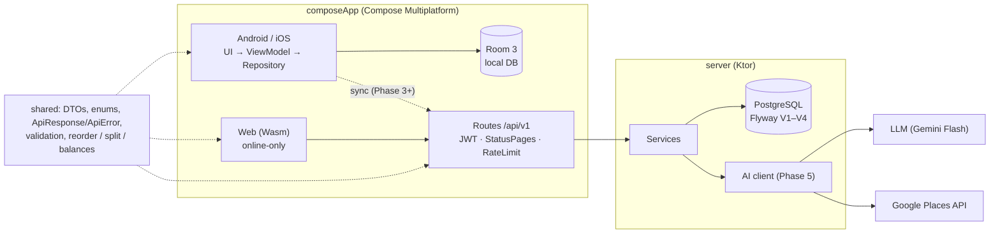

# TRD — RANSEL

Oct 27, 2026 · @SEN

## Technical summary

One Kotlin codebase: a Compose Multiplatform app (Android, iOS, Web Wasm), a Ktor server, and a `shared` module for data models, validation, and the API contract. On Android and iOS, data is stored locally first (offline-first) and then synced to PostgreSQL. The web app is online-only: it has no local database, calls the API directly, and requires signing in. AI recommendations are computed on the server; the client never holds an API key.

Principles:

- Every phase ships a usable app; Phase 1 runs without a server.
- If a class travels over the network or its rules must match on app and server, it lives in `shared`.
- Money is always a `Long` in the smallest unit (`amountMinor`), never a `Double`.
- IDs are created on the client (UUID), and every table has `created_at`, `updated_at`, `deleted_at` for sync.
- Product requirements and business rules live in PRD — RANSEL; this document explains how to build them.

## Architecture

The Android and iOS apps read from and write to a local Room database; sync to the server runs in the background over HTTPS. The web app reads and writes through the API only, because it is always loaded from the server anyway. The server holds shared data in PostgreSQL and is the only party that calls the LLM and the Places API.



The `shared` module is used by both app and server, so models, validation, and calculations (reorder, split bill, balances) are identical on both sides.

## Tech stack and modules

| Layer | Choice | Notes |
| --- | --- | --- |
| UI | Compose Multiplatform | Android, iOS, Web (Wasm) |
| Navigation | Navigation Compose (multiplatform) |  |
| State | ViewModel + StateFlow | Lifecycle ViewModel is multiplatform |
| DI | Koin |  |
| Local database | Room 3 (androidx.room3), Android and iOS only | Stable KMP support and familiar from Android; the web app needs no local database |
| Networking | Ktor Client + kotlinx.serialization | Engine per platform via expect/actual |
| Dates and money | kotlinx-datetime, `Long` in the smallest unit | M3 DatePicker uses UTC millis |
| Resources | Compose Resources | Strings in `values/` (EN) and `values-in/` (ID), illustrations as WebP |
| Backend | Ktor Server | Routing, Authentication (JWT), StatusPages, RateLimit |
| Server database | PostgreSQL + Exposed | Flyway migrations |
| Infrastructure | Docker Compose | Local Postgres in development, server image for deploy |
| AI (Phase 5) | LLM (Gemini Flash, Gemini Developer API) + Google Places API | Called from the server only; model id from `LLM_MODEL` |

Repository layout: one Gradle project with three modules, generated from the kmp.jetbrains.com template with the Server option.

```text
ransel/
├── composeApp/   UI for every platform (commonMain + androidMain/iosMain/wasmJsMain)
├── shared/       @Serializable models, ApiResponse/ApiError, validation, domain logic
└── server/       Ktor: routes, services, repositories (Exposed), Flyway migrations
```

## Data model

Every table uses a client-generated UUID plus `created_at`, `updated_at`, `deleted_at` (soft delete). The migrations live in `db/migration` as V1–V4, one per phase, and already contain every table and column below. Changes from the design discussion were folded into them directly, because no database has been created yet. After the first deploy, existing migrations are never edited again; changes go into new files (V5 onwards).

| Table | Main columns | Migration (phase) |
| --- | --- | --- |
| trips | id, owner\_id, title, destination, start\_date, end\_date (both null = "Tanggal belum pasti", V26), base\_currency, budget\_minor, cover\_url | V1 (1–2) |
| itinerary\_items | id, trip\_id, day\_date (null = unscheduled), start\_time, end\_time, title, category, place\_name, place\_id, lat, lng, duration\_min (AI estimate), notes, booking\_url, source (MANUAL/AI), sort\_order DOUBLE | V1 (1–2) |
| packing\_items | id, trip\_id, category, name, quantity, is\_packed, sort\_order | V1 (1–2) |
| packing\_templates | id, owner\_id (null = built-in), name, items JSONB; shared\_trip\_id added in V3 | V1, V3 |
| expenses | id, trip\_id, amount\_minor, currency, fx\_rate\_to\_base, category, payment\_method, note, spent\_at, paid\_by\_member\_id (V15; was paid\_by\_user\_id); **V18:** is\_estimate (paid\_from\_kitty dropped in V24) | V1 (1–2), V15, V18, V24 |
| users | id, display\_name; email, password\_hash, default\_currency added in V2 | V1, V2 |
| refresh\_tokens | id, user\_id, token\_hash, device\_name, expires\_at, revoked\_at | V2 (3) |
| password\_reset\_tokens | id, user\_id, token\_hash, expires\_at, used\_at | V2 (3) |
| trip\_members | trip\_id, user\_id, role (OWNER/EDITOR/VIEWER), joined\_at; **V15:** `id` (the primary key), `user_id` nullable (a member added by name), display\_name, phone, claimed\_at, claimed\_by\_member\_id, removed\_at | V3 (4), V15 |
| trip\_invites | code, trip\_id, created\_by, role, max\_uses, used\_count, expires\_at, revoked\_at | V3 (4) |
| expense\_splits | expense\_id, member\_id (V15; was user\_id), share\_minor | V3 (4), V15 |
| settlements | id, trip\_id, from\_member\_id, to\_member\_id (V15; were from/to user\_id), amount\_minor, settled\_at; **V18:** status (CLAIMED\_PAID, CONFIRMED), claimed\_at | V3 (4), V15, V18 |
| member\_claims | id, trip\_id, guest\_member\_id, claimed\_by\_member\_id, moved JSONB (ids of the rewritten rows, for undo), claimed\_at, undone\_at | V15 |
| polls, poll\_options, poll\_votes | polls: trip, kind (8), question, created\_by\_member\_id, closes\_at, multi\_choice, is\_anonymous, anonymity\_locked, apply\_winner, day\_date/start\_time (FOOD), status (OPEN/TIED/CLOSED/DECIDED), decided\_option\_id, tied\_at. Options: label, dates, place, url, price, min/max, `version`. Votes: (option, member, option\_version) | V16 |
| expense\_items | expense\_id, sort\_order, name, amount\_minor, member\_ids JSONB (empty = tax/service spread in proportion); the splits stay the source of truth | V18 |
| payment\_methods | id, user\_id, kind (BANK/EWALLET), provider, account\_number, holder\_name, is\_primary | V18 |
| comments | id, trip\_id, target\_kind (ITINERARY\_ITEM/EXPENSE/POLL\_OPTION), target\_id, author\_member\_id, body (1–1,000), mentions JSONB, created\_at, edited\_at, deleted\_at | V15 |
| place\_autocomplete\_cache, place\_details\_cache; trips.dest\_place\_id, dest\_lat, dest\_lng, dest\_viewport | destination suggestions (24 h) and details (30 days); the picked destination's place | V19 |
| fx\_rates; trips.country\_code, local\_currency, time\_zone; expenses.fx\_source, fx\_date | ECB daily rates per currency (per euro); an overseas trip's locale; where an expense's rate came from | V20 |
| personal\_items | id, trip\_id, owner\_member\_id, category, name, quantity, is\_packed, sort\_order, source\_item\_id (the members' list line it came from), required; **V25:** customized | V21, V25 |
| member\_lists, member\_list\_items, member\_list\_recipients; packing\_items.assignee\_member\_id | the owner's members' packing list (one per trip, `version`), its lines, its chosen recipients; who brings a Bersama item | V21 |
| guest\_sessions; polls.share\_code | guest page: token hash per browser and member; a poll's guest link | V22 |
| trip\_documents, trip\_templates | documents (FILE on the VPS disk or LINK) and trip templates (itinerary by day number + packing) | V23 |
| recommendation\_cache | query\_hash, destination, response JSONB, model, hit\_count, expires\_at | V4 (5) |
| recommendation\_feedback | trip\_id, user\_id, place\_id, place\_name, category, action (LIKE/SKIP) | V4 (5) |
| credit\_wallets, credit\_daily, credit\_ledger | wallet balance per user (created with the signup grant), free credits used per WIB day, append-only ledger (SPEND/SIGNUP\_GRANT/VOUCHER/TOPUP/...) | V8 (5) |
| credit\_vouchers, credit\_voucher\_redemptions | top-up codes, one redemption per user per code | V8 (5) |
| devices | push token per phone (platform, locale, disabled\_at) | V10 |
| notifications | inbox: type, params, trip, dedupe\_key (unique per user), read\_at, push\_state (outbox) | V10 |
| notification\_settings | three switches per user (missing row = all on) | V10 |
| admin\_audit\_log; users.disabled\_at; credit\_ledger.note | append-only log of admin actions; account deactivated by an admin; the admin's reason for an ADJUSTMENT (which may now be negative) | V12 (6) |
| email\_verification\_tokens; users.email\_verified\_at | sign-up email link (hash only, 24 h, newest link only); when the email was verified (existing accounts backfilled) | V13 (3) |
| app\_settings | admin overrides of config values (key, JSON value, updated\_by) | planned (6) |
| ai\_search\_log, error\_counts | one row per Explore search (parameters, source, latency, credits, estimated cost); errors per hour, code and route | planned (6) |

Enums:

- `category` on itinerary\_items and expenses uses one shared enum: ATTRACTION, FOOD, TRANSPORT, LODGING, SHOPPING, OTHER. Itinerary labels: Wisata/Explore, Kuliner/Eat, Perjalanan/Travel, Menginap/Stay, Belanja/Shop, Lainnya/Other. Expense labels: Aktivitas/Activities, Makan/Food, Transport, Penginapan/Lodging, Belanja/Shopping, Lainnya/Other. Both use the same color per value.
- AI core interests: NATURE, FOOD, CULTURE, SHOPPING, ADVENTURE, NIGHTLIFE, PHOTO, RELAX (destination interests are free strings from the AI). Price level: LOW, MEDIUM, HIGH. Style: SANTAI, PADAT. Details: `docs/specs/AI-Recommendation-Spec.md`, which wins over this section for Explore.
- Expense `payment_method` (the "Bayar pakai" field): CASH, DEBIT\_CARD, CREDIT\_CARD, TRANSFER, E\_WALLET, OTHER; default CASH.

Notes:

- `sort_order` is fractional so moving one item only changes one row (a value between its neighbours); an itinerary reorder also rewrites the times in the affected range.
- The currency is stored per expense together with fx\_rate\_to\_base (the rate when the expense was recorded, so old totals stay fixed); conversion to `base_currency` happens when the summary is shown.
- In Phase 1, `owner_id` holds a fixed local ID, replaced by the real user ID on sign-in.
- **Members (V15, 25 Oct 2026).** People in a trip are `trip_members` rows with their own `id`, and a member does not need an account (the OWNER adds people by name; they are always VIEWER and have no inbox). Expenses, splits, payers and settlements point at `trip_members.id`. The id of an account's own row is `memberIdFor(tripId, userId)` (`shared/domain/MemberIds.kt`: the first 16 bytes of SHA-256 of `<tripId>:<userId>`, shaped like a UUID v5), so the apps write `paidByMemberId` offline without asking the server; guest data uses `memberIdFor(tripId, LOCAL_USER_ID)` and is rewritten at sign-in. V15 backfilled every id with the same function in SQL (`MemberIdMigrationTest` keeps the two equal). **Polls (V16, 26 Oct 2026).** A poll is closed by the clock: whoever reads or votes first after `closes_at` turns OPEN into CLOSED (a winner can be confirmed) or TIED (the creator picks among the tied options; the minute job reopens a tie for 24 hours if nobody decided after 24 hours). Only the creator or the trip OWNER closes, confirms, reopens or deletes; a creator who leaves hands their polls to the owner. The winner action (`shared/domain/Polls.kt`) runs in the transaction that sets `decided_option_id`: DATE sets the trip dates (activities on removed days become unscheduled), DESTINATION the destination, PLACE adds an unscheduled place, FOOD an activity on the poll day and time. STAY, BUDGET, TRANSPORT and CUSTOM only record the result: the STAY estimate arrives with the group money step, and the budget range is not copied to the trip (Jelajah will read the decided BUDGET poll). A DATE poll gives a trip without dates its dates (V26) or replaces the ones it has. A DATE poll is made with 2–5 ranges, none before today (`validateDatePollOptions`; the server takes "today" as the earliest date on earth, UTC−12) and never holds more than 5 (`maxPollOptions`, also for options added later); editing a range is not checked against today. Anonymous polls never return who chose what; the switch locks at the first vote (`anonymity_locked`, so taking the vote back does not unlock it). Members added by name cannot vote until the guest web page (step 8).

**Trip documents and templates (V23, 26 Oct 2026).** `trip_documents` (id, trip, title, category, kind FILE/LINK, url, file name, mime, size, itinerary item, uploader, soft delete). Files sit on the VPS disk (a Docker volume, `DOCUMENTS_DIR`), not in object storage: owner decision 26 Oct 2026 (the TRD's presigned upload is replaced by an upload through the API and a signed download link valid 15 minutes). Limits 20 MB per file and 200 MB per trip; files stay while the trip exists and are removed when the trip is deleted. A STAY poll winner with a link adds a LINK document. `trip_templates` (owner, name, day count, destination, items and packing as JSON). The recap is computed on the device (`domain/Recap.kt`); the server only sends `RECAP_READY` the day after the trip ends.

**Guest page (V22, 26 Oct 2026).** `polls.share_code` (unique, null = no link or turned off); `guest_sessions` (token hash, trip, member, created, last seen; one live session per member). A guest is a member without an account: picking "Nama saya tidak ada" adds one (role VIEWER). Guests vote like members and tick the packing lines they got: the owner's member list now also goes to members without an account. Owner decisions 26 Oct: one static preview image, a written name becomes a member, one browser per name with an IP rate limit, no OTP or captcha.

**Trips without dates (V26, 28 Oct 2026).** `trips.start_date` and `end_date` may both be null while the group picks the dates with a DATE poll (PRD "Date poll"; `trips_date_range` = both null, or both set with end ≥ start; one date alone is 422 `REQUIRED` from `validateTrip`). Such a trip has no days: `daysTotal` 0, every itinerary item is unscheduled (`dayFitsTrip`; REST answers 422 `dayDate` = `OUTSIDE_TRIP` for a day outside the trip, dated or not, while a sync push keeps the item but stores it unscheduled), and clearing the dates unschedules every item. Deciding a DATE poll sets the dates. Explore searches with a neutral 3 days from the first day of next month (WIB) and never answers `TRIP_ENDED`; no packing reminder or recap until the trip has dates; a template saved from it has `day_count` 0 (V26 relaxes the CHECK) and only unscheduled lines.

**Group packing (V21, 26 Oct 2026).** The trip-wide `packing_items` are now the "Bersama" list and gain `assignee_member_id` ("Saya bawa"; once set only that member ticks it). Each member's own list is the new `personal_items` (owner\_member\_id, source\_item\_id, required); sync sends a member only their own lines. `member_lists` (one per trip: name, version, sent\_to\_all, sent\_at) with `member_list_items` and `member_list_recipients`: sending creates a personal line per recipient and item; saving a sent list applies `diffMemberList` to every recipient (new lines added, removed lines deleted, changed lines updated; check marks and own lines stay); a member who joins later gets the list when it was sent to everyone. Owner decision 26 Oct: the items a trip already had stay as Bersama, Pribadi starts empty. **27 Oct (owner, V25):** the members' list is OWNER only (read, save, send, progress, remind; editors and viewers get 403), and a member's copies are theirs to edit and delete like their own lines. `personal_items.customized` marks a copy the member edited (name, quantity or category); later saves of the list add new lines everywhere but change or remove only copies that are not `customized`, and a copy the member deleted is never copied again (`copyMissing` counts deleted rows as had). The author gets copies too, and a line someone already keeps (same category and name) is linked (`source_item_id` set) instead of added twice; progress and reminders stay for the recipients.

**Overseas trips (V20, 26 Oct 2026).** `trips` gains `country_code`, `local_currency` and `time_zone`, set from the picked place (its country through `shared/domain/CountryCurrencies.kt`, its zone from the Google Time Zone API looked up with the place details) and editable. `expenses` gains `fx_source` (DAILY, MANUAL) and `fx_date`. An expense keeps its amount in its own currency with `fx_rate_to_base`, as since Phase 2: that already is the original amount the TRD of 24 Oct asks to keep, so `orig_amount`/`orig_currency` are not added and `amount` is not moved to the base currency (it would break every client; balances already convert per expense). `fx_rates` (rate\_date, currency, per\_euro) is filled once a day from the ECB 90-day history file; `GET /fx/rate` crosses two currencies through EUR and falls back to the latest earlier day (`stale`). Itinerary times were always stored as local wall-clock times; the apps now show expenses' days and "now" in the trip's zone.

**Destinations (V19, 26 Oct 2026).** `trips` gains `dest_place_id`, `dest_lat`, `dest_lng`, `dest_viewport` (JSONB) for a destination picked from the suggestions (`TripDto.destinationPlace`); `destination` keeps the name. `place_autocomplete_cache` (24 h) and `place_details_cache` (30 days) are Postgres tables, not Redis (owner decision 26 Oct: no new container). The fallback list of 38 provinces and 514 cities and regencies lives in `shared` (`IndonesianRegions.kt`, from github.com/cahyadsn/wilayah, MIT), so the server fallback and the apps offline or signed out search the same names; no pg\_trgm. Jelajah biases its place lookups to the stored destination coordinates when the search is for the trip's own destination.

**Group money (V18, 26 Oct 2026).** The kitty ("Kas") was removed on 27 Oct 2026 by the owner (V24 drops `kitty`, `kitty_deposits` and `expenses.paid_from_kitty`; it never reached production). Balances go through `shared/domain/GroupMoney.kt` `tripBalances`: estimates are left out, settlements count once CONFIRMED (a claim waits for the receiver, or the OWNER when the receiver has no account). A STAY poll winner adds an estimated LODGING expense (`stayEstimateMinor`: price × nights by default) paid by the poll creator and split equally; saving it with `isEstimate = false` turns it into the payment. Receipt photos are read by Gemini (`POST /receipts/parse`, `CREDIT_COST_RECEIPT`, default 1 credit: about Rp50 of tokens per photo against Rp550–667 per credit) and nothing is stored until the expense is saved; with receipt `items` the server derives the splits with `splitByItems`. A claim moves receipt lines with the rest. The booking link of a STAY winner is saved with trip documents (step 9).

Removing, leaving or being claimed sets `removed_at`; the row stays so old expenses keep a name, and rejoining reuses the row. The TRD of 24 Oct said to fold this into V3; V1–V4 are live, so it is the new migration V15.

## API

Every endpoint sits under `/api/v1`. From Phase 3, every endpoint except auth requires `Authorization: Bearer <access_token>`. Rows marked ★ were added during the design discussion.

| Method | Path | Purpose | Phase |
| --- | --- | --- | --- |
| GET | /health | Server check | 2 |
| GET, POST | /trips | List / create trips (dates optional: both or neither) | 2 |
| GET, PUT, DELETE | /trips/{id} | Detail + summary / update / delete (soft) | 2 |
| GET, POST | /trips/{id}/itinerary | List / add activities | 2 |
| PUT, DELETE | /trips/{id}/itinerary/{itemId} | Update (including scheduling: set day\_date + times) / delete | 2 |
| PUT ★ | /trips/{id}/days/{date}/order | Save the new order + times of one day: items \[{id, sortOrder, startTime, endTime}\] | 2 |
| GET, POST | /trips/{id}/packing | List / add items | 2 |
| PATCH | /trips/{id}/packing/{itemId} | Tick / update an item | 2 |
| DELETE ★ | /trips/{id}/packing/{itemId} | Delete an item | 2 |
| POST ★ | /trips/{id}/packing/uncheck-all | Uncheck all items | 2 |
| GET, POST | /trips/{id}/expenses | List / record (Phase 4: paidBy + splits) | 2 |
| GET | /trips/{id}/expenses/summary | Totals per category and per day | 2 |
| PUT, DELETE ★ | /trips/{id}/expenses/{expenseId} | Edit (splits replaced whole) / delete an expense | 2 |
| POST | /auth/register, /auth/login, /auth/refresh | Account and tokens | 3 |
| POST ★ | /auth/logout | Sign out this device (revokes its refresh token) | 3 |
| POST ★ | /auth/password/forgot, /auth/password/reset | Forgot password | 3 |
| POST ★ | /auth/email/verify (public), /auth/email/resend (bearer) | Verify the email after sign-up; send a new link | 3 |
| GET, PATCH ★ | /me | Profile, default currency | 3 |
| GET, POST | /sync | Pull changes since a timestamp (optionally a few trips per page: `tripLimit`, `afterTripId`, `nextTripId`) / push a local batch | 3 |
| POST | /trips/{id}/invites | Create an invite code (role, maxUses, expiresAt) | 4 |
| GET ★ | /trips/{id}/invites | List invites with usage, for the Members screen | 4 |
| DELETE ★ | /trips/{id}/invites/{code} | Revoke an invite | 4 |
| GET ★ | /invites/{code} | Trip preview for the Join trip screen. **Public** (no bearer, rate limited per IP): initials of the members, names of the members added by name, activity count, total shared spend; no amount per person, phone or payment info | 4 |
| POST | /invites/{code}/accept | Join the trip | 4 |
| GET ★ | /guest/{code} | Guest page (stage 8). **Public**, rate limited per IP; {code} = a poll share code or a live invite code; header `X-Guest-Token`. Trip title and dates, member names, the guest's own member, open polls (plus the linked one), the guest's packing lines from the owner's list, and `myMoney`: the guest's own paid, share and balance in the base currency plus the "Supaya lunas" transfers that involve them (null without a name or without a part in any expense; never other members' balances or payment info) | 4 |
| POST ★ | /guest/{code}/identity | Pick a member without an account or write a new name (it becomes a member without an account, role VIEWER, owner notified); one browser per name; 409 GUEST_NAME_TAKEN / GUEST_NAME_EXISTS | 4 |
| POST ★ | /guest/{code}/polls/{pollId}/votes | A guest's vote, same rules as members (401 GUEST_NAME_REQUIRED without a token) | 4 |
| PATCH ★ | /guest/{code}/personal-items/{itemId} | A guest ticks a line of their packing list | 4 |
| GET, POST | /trips/{id}/documents | Trip documents (stage 9): list with storage use; POST a link (JSON) or a file (multipart `meta` + `file`, PDF or image, 20 MB, 200 MB per trip; EDITOR+) | 4 |
| PATCH, DELETE | /trips/{id}/documents/{docId} | Rename, regroup, link to an activity; delete (uploader or OWNER) | 4 |
| GET | /trips/{id}/documents/{docId}/download | A signed download link valid 15 minutes | 4 |
| GET ★ | /files/documents/{docId}?exp=&sig= | The file bytes (signed link, no bearer) | 4 |
| GET, POST, DELETE | /trip-templates, /trip-templates/{id} | My trip templates; POST copies a trip's itinerary (by day number) and shared packing list | 4 |
| POST, DELETE | /polls/{id}/share | The poll's guest link (`https://ransel.mietek.tech/p/<code>`); DELETE (creator or OWNER) turns it off | 4 |
| DELETE | /trips/{id}/members/{memberId}/guest-session | OWNER: release a guest name so another browser can use it | 4 |
| GET ★ | /og/p/{code}, /og/j/{code} | HTML with Open Graph tags for WhatsApp and other link previews (static image, text per poll or trip); nginx sends only crawler user agents here | 4 |
| GET, POST | /trips/{id}/members | List members (phone of a member added by name: OWNER only) / add a person by name (OWNER) → 201 | 4 |
| PATCH, DELETE ★ | /trips/{id}/members/{memberId} | Change role / remove member (a member added by name is always VIEWER) | 4 |
| POST, DELETE | /trips/{id}/members/{memberId}/claim | "Kamu yang mana?": the caller takes over a member added by name, everything that pointed at it moves in one transaction (409 `MEMBER_ALREADY_CLAIMED`, `MEMBER_HAS_ACCOUNT`) / the OWNER undoes it | 4 |
| GET, POST | /trips/{id}/comments | Comments of one item (`?targetKind=&targetId=`) / add one (any member with an account, any role) | 4 |
| GET | /trips/{id}/comments/counts | Number of comments per target (`?targetKind=`), so lists can show a count without fetching the comments | 4 |
| PATCH, DELETE | /comments/{id} | Edit / delete a comment (author only); a new @mention notifies that member | 4 |
| GET, POST | /trips/{id}/polls | List polls (newest first) / create one (OWNER or EDITOR). Polls past `closes_at` are settled on the way | 4 |
| GET, PATCH, DELETE | /polls/{id} | One poll / change question, closing time, choices, anonymous switch (creator or OWNER) / delete | 4 |
| POST | /polls/{id}/options | Add an option (while OPEN) | 4 |
| POST | /polls/{id}/options/bulk | Add several options at once (all or none; the ticked Jelajah results) | 4 |
| POST | /polls/{id}/search | Jelajah for a STAY or FOOD poll: AI places for an area, budget and wishes; costs a new search | 4 |
| POST | /link-preview | Title and picture of a pasted link (SSRF-safe fetch, cached 7 days, no price); 422 LINK_UNREADABLE | 4 |
| PATCH, DELETE | /polls/{id}/options/{optionId} | Edit (bumps `version` and clears the votes when label, dates, place, link or price change) / delete | 4 |
| PUT | /polls/{id}/votes | Replace my votes; each vote carries the option version it saw (409 `VOTE_STALE`, 409 `POLL_CLOSED`) | 4 |
| POST | /polls/{id}/close, /decide, /reopen | End voting now / confirm the winner and run its action (no option = dismiss) / reopen a closed or tied poll | 4 |
| POST ★ | /trips/{id}/leave, /trips/{id}/transfer-ownership | Leave the trip / transfer ownership | 4 |
| GET | /trips/{id}/balances | Balance per person + fewest transfers | 4 |
| POST ★ | /trips/{id}/settlements | Mark as settled (CONFIRMED at once) | 4 |
| GET ★ | /trips/{id}/settlements | List settlements (with `status`: CLAIMED\_PAID waits for the receiver) | 4 |
| POST | /trips/{id}/settlements/claim | "Saya sudah bayar": the caller's member claims a payment → CLAIMED\_PAID, the receiver is notified | 4 |
| POST | /trips/{id}/settlements/{id}/confirm | The receiver (or the OWNER for a receiver without an account) confirms; only then it counts in balances (409 `SETTLEMENT_NOT_CLAIMED`) | 4 |
| DELETE | /trips/{id}/settlements/{id} | Remove a settlement (payer, receiver or OWNER), e.g. a claim that never arrived | 4 |
| GET | /trips/{id}/settlements/{from}/{to}/pay-info | "Bayar ke": amount and the receiver's payment info, only for the caller's member while it owes the receiver (else 403) | 4 |
| GET, POST, PATCH, DELETE | /me/payment-methods[/{id}] | Account → Info pembayaran (bank accounts and e-wallets, at most 10) | 4 |
| POST | /receipts/parse?tripId= | Receipt photo (body = image, ≤ 5 MB) → `ReceiptDraftDto`; Gemini reads it; costs `CREDIT_COST_RECEIPT` (default 1), nothing when unreadable (422 `RECEIPT_UNREADABLE`, 413 `FILE_TOO_LARGE`) | 4 |
| POST, DELETE | /trips/{id}/packing/{itemId}/bring | Bersama: "Saya bawa" / give it back; once brought, only the bringer ticks it | 4 (group trips) |
| GET, POST, PATCH, DELETE | /trips/{id}/personal-items[/{itemId}] | Pribadi: the caller's own lines, also the copies of the owner's list (an edited copy is marked `customized`) | 4 (group trips) |
| GET, PUT | /trips/{id}/member-list | "Daftar bawaan anggota" (OWNER only): the list / save it with the version edited (409 `LIST_STALE`); a sent list's changes reach every copy a member has not edited | 4 (group trips) |
| POST | /trips/{id}/member-list/send, /remind | OWNER: send to chosen members or everyone (later members too; the owner gets copies too), optionally as a template / push reminder, once per member per 12 h | 4 (group trips) |
| GET | /trips/{id}/member-list/progress | OWNER: required ("Wajib") and all lines ticked per recipient, for "Progres anggota" | 4 (group trips) |
| GET, POST ★ | /packing-templates | Built-in + user templates / save a template | 4 |
| POST ★ | /trips/{id}/packing/apply-template | Use a template (option to skip items already there) | 4 |
| POST, DELETE ★ | /devices | Register / refresh this phone's push token; remove it on sign-out | 5 |
| GET ★ | /notifications | Inbox page + unread count | 5 |
| POST ★ | /notifications/read | Mark some or all read | 5 |
| GET, PATCH ★ | /notification-settings | The three switches | 5 |
| GET ★ | /credits | Balance, free credits left today, cost per action | 5 |
| GET ★ | /credits/ledger | Credit history, newest first | 5 |
| GET ★ | /credits/packages | Top-up packs and prices (`purchasable` is false until a payment provider exists) | 5 |
| POST ★ | /credits/redeem | Redeem a voucher code | 5 |
| GET | /explore/suggestions | Destination interests + suggested price level for the Explore form (costs no credits); `tripId`, optionally with `destination` to use another place than the trip's | 5 |
| POST | /recommendations | AI recommendations from preferences | 5 |
| POST ★ | /recommendations/feedback | LIKE / SKIP per place | 5 |
| DELETE ★ | /recommendations/feedback/{tripId}/{placeId} | Undo the last swipe | 5 |
| GET ★ | /trips/{id}/rounds | Open and recent voting rounds (banner, trip-list dot); any member | 5 |
| GET ★ | /trips/{id}/rounds/{roundId} | One round: cards, my votes; OWNER also tally with names and voters, members counts after closing | 5 |
| PUT ★ | /trips/{id}/rounds/{roundId}/votes/{placeId} | Vote LIKE / SKIP (idempotent); DELETE = undo; 409 `VOTING_CLOSED` | 5 |
| POST ★ | /trips/{id}/rounds/{roundId}/decide | OWNER picks the places that enter the itinerary and closes the round | 5 |
| POST ★ | /trips/{id}/rounds/{roundId}/close | OWNER ends voting now; members can no longer vote, the OWNER still decides | 5 |
| GET | /places/autocomplete?q=&session=[&near=lat,lng] | Destination suggestions (Google Places Autocomplete New: languageCode id, regionCode id, Indonesia bias, primary types locality, administrative\_area\_level\_1/2, country, tourist\_attraction; airports left out because Google takes 5 types at most, owner decision 26 Oct). Cached 24 h per normalised query (Postgres). Google down or slow (1.5 s): `fallback = true` and the built-in region list (`shared/domain/IndonesianRegions.kt`). 60 per user per minute | 5 (group trips) |
| GET | /places/{placeId}?session= | Coordinates, viewport and country of a picked suggestion (Place Details Essentials: id, location, viewport, addressComponents, types; never displayName). Ends the autocomplete session. Cached 30 days; 503 `PLACES_UNAVAILABLE` | 5 (group trips) |
| GET | /places/reverse?lat=&lng= | "Gunakan lokasi saat ini": 2–3 levels (area, city or regency, "Sekitar <city>") from the Geocoding API. Coordinates are neither logged nor stored | 5 (group trips) |
| GET | /places/popular | "Populer untuk trip grup": destinations picked by at least 3 different trip owners in the last 90 days, recomputed once a day | 5 (group trips) |
| GET | /fx/rate?from=&to=&date= | Exchange rate for an expense: ECB reference rates (daily job, kept in `fx_rates`) crossed through EUR; the latest on or before the day, `stale` when earlier; 404 for a currency the ECB does not quote | 5 (group trips) |
| GET | /places/photo/{placeId}?exp=&sig= | Signed place-photo proxy (no bearer; 404 if no photo) | 5 |
| GET | /places/{placeId}/detail | Saved detail text of a place (about, tips, hours estimate) to open it again from the itinerary; rebuilt by one small LLM call when expired | 5 |
| GET, POST ★ | /admin/... | Admin app (Karung): users (list, add with an invite email), credit adjustments, audit log, overview, Explore AI, system, settings, content. Only accounts in `ADMIN_EMAILS` with a verified email; full list in `docs/specs/admin-spec.md` "API" | 6 |
| GET ★ | /content?version= | Published remote content for the apps (apps call it in a later step) | 6 |

The exact request and response classes for every row are in the `shared` module (`api/ApiRoutes.kt`, `dto/`), which is the contract between the app and the server.

**Response format.** Success or failure is read from the HTTP status code. Success: `{"data": …}` (lists add `meta` for paging); failure: `{"error": {"code", "message", "details"}}`. 201 for create, 204 for delete, 400/422 for validation, 401 for tokens, 403 for no permission, 404, 409 for conflicts, 429 for quota, 500 without a stack trace.

**Error codes** are fixed constants for app logic and are shown small on the state screens (the full list is `shared/.../api/ErrorCode.kt`): `NETWORK_TIMEOUT` (client), `INTERNAL_ERROR`, `TOKEN_EXPIRED`, `TRIP_NOT_FOUND`, `INVITE_EXPIRED`, `INVITE_REVOKED`, `INVITE_FULL`, `AI_UNAVAILABLE`, `RATE_LIMITED`, `SPLIT_TOTAL_MISMATCH`, `PAYER_TOTAL_MISMATCH`, `OWNER_CANNOT_LEAVE`, for voting `ROUND_NOT_FOUND`, `VOTING_CLOSED`, `ROUND_ALREADY_DECIDED`, `ROUND_LIMIT`, for group trips `MEMBER_ALREADY_CLAIMED`, `MEMBER_HAS_ACCOUNT`, `POLL_CLOSED`, `POLL_LOCKED`, `VOTE_STALE`, `LINK_UNREADABLE`, `SETTLEMENT_NOT_CLAIMED`, `RECEIPT_UNREADABLE`, `FILE_TOO_LARGE`, `STORAGE_FULL`, `UNSUPPORTED_FILE`, `LIST_STALE`, `GUEST_NAME_TAKEN`, `GUEST_NAME_EXISTS`, `GUEST_NAME_REQUIRED`, `PLACES_UNAVAILABLE`, for credits `INSUFFICIENT_CREDITS` (402) and the voucher codes, and `ACCOUNT_DISABLED` (403, an admin deactivated the account).

Conventions: camelCase fields, ISO 8601 dates, UTC times, money in the smallest unit. The `ApiResponse<T>` and `ApiError` wrappers live in `shared`; the server wraps responses with `call.respondData(...)` and StatusPages; the client maps them to `sealed interface ApiResult<T> { Success, Failure }`.

## Offline-first sync

On Android and iOS, the local database is the source of truth for the UI; the server is only the sync target. Conflicts are resolved last-write-wins per row by `updated_at`.

1. Every local write saves the row with `updated_at = now` and marks it `pending` (used by the UI for the "waiting to sync" marker and the change count on the Session expired screen).
2. When online, a worker sends every `pending` row in one batch with `POST /sync`.
3. The server applies each row if its `updated_at` is newer than the stored one, checks access per trip, and returns accepted and rejected rows with reasons.
4. The client pulls other changes with `GET /sync?since=<lastSyncAt>`, overwrites older local rows, and stores `lastSyncAt` from the server clock. Mobile pages the pull 20 trips at a time (`tripLimit`, then `afterTripId = nextTripId` until it is null) and stores the first page's `serverTime` only after the last page.
5. The UI shows the snackbar "Back online · n changes sent".

Supporting rules:

- Deletes are always soft (`deleted_at`) so they sync too; permanent cleanup runs periodically on the server.
- An itinerary reorder writes several rows at once (order + times); the batch is applied in one transaction so a day is never half-sorted.
- Refused rows (mobile): a rejected row is marked `REJECTED` and never re-sent, and the next pull is a full one, which puts the server's copy back over every refused row the server has. After that full pull completes, a row still `REJECTED` is one the server does not have (created after the user lost edit access, the trip is gone, or refused as invalid): it is deleted from the device and one snackbar says what was lost, e.g. "2 pengeluaran dan 1 aktivitas di “Bali 4 hari” tidak tersimpan karena kamu tidak punya akses edit lagi." The notice waits in the preferences until the app is on screen (owner, 29 Oct 2026).
- If the refresh token expires while changes are pending → Session expired screen; the changes stay local until the user signs in again.
- Data from "Use without an account for now" uses a fixed local ID; on the first sign-in, `owner_id` and `paid_by_user_id` are replaced with the user ID and synced.
- Features that need the server (Explore AI, invites, members) show the connection error state when offline.

## Domain logic

Everything in this section lives in `shared` so the app (offline) and the server compute the same thing.

**Itinerary reorder.** Durations are kept; the affected range is packed from the earliest start time in that range.

```kotlin
data class Slot(val id: String, val start: LocalTime, val end: LocalTime)

fun reorder(items: List<Slot>, from: Int, to: Int): List<Slot> {
    if (from == to) return items
    val lo = minOf(from, to); val hi = maxOf(from, to)
    val moved = items.toMutableList().apply { add(to, removeAt(from)) }
    var cursor = items[lo].start.min()
    for (i in lo..hi) {
        val duration = moved[i].end.min() - moved[i].start.min()
        moved[i] = moved[i].copy(start = cursor.toTime(), end = (cursor + duration).toTime())
        cursor += duration
    }
    return moved
}
private fun LocalTime.min() = hour * 60 + minute
private fun Int.toTime() = LocalTime(this / 60, this % 60)
```

The result is sent to `PUT /trips/{id}/days/{date}/order`. Undo simply resends the list as it was before the reorder.

**Schedule a place.** `start` = the `end` of the day's last activity, or 09:00 if the day is empty; `end` = `start` + `duration_min` from the AI; `sort_order` = last + 1. The user can change the time before saving.

**Auto-schedule** (`domain/AutoSchedule.kt`, `autoSchedule(places, days)`; owner, 27 Oct 2026). A pure function, no AI and no endpoint: every place has `lat`/`lng`, `duration_min` and a category, and the result must be the same offline on every device. (1) A place within 5 km of an activity a day already has goes to that day. (2) The rest follow one nearest-neighbour route that is cut into days in order; a day stops taking places when it has its share (route minutes divided by the days with room, plus 30 min), when the next place is more than 15 km from the last, or when it no longer fits between 09:00 and 20:00. Cost of a place = its duration (15 min to 10 h, default 60) + travel from the previous one (15 min + straight-line km at 25 km/h). (3) Inside a day the order follows the route, but a place to eat goes first at lunch (from 11:30, waiting at most 60 min) and dinner (from 17:30). (4) New activities start when the last existing one ends (09:00 on an empty day, times rounded up to 5 min) and get `sort_order` after the day's last; existing ones are never changed. (5) Places without coordinates go to the day with most room, at its end. What does not fit is returned as `leftOver` and stays unscheduled. The app (`ItineraryViewModel.previewAutoSchedule` / `runAutoSchedule`) saves each place through the normal itinerary path and offers Undo by saving the originals again. A real routing API (Google Routes) is left out: it costs per request and needs a connection.

**Split bill.** Split equally: `share = amount / n`; the rounding remainder (in the smallest unit) goes to the payer so the total always matches. Set amounts: the server rejects with `SPLIT_TOTAL_MISMATCH` if the shares do not add up to the amount.

**Balances and fewest transfers.** `balance(user) = Σ paid − Σ share + Σ settlements paid − Σ settlements received`. Fewest transfers are computed greedily: pair the largest debtor with the largest creditor and repeat until everything is zero. For small groups the result is close enough to the minimum.

**Invites.** Code = a prefix from the trip name + 8 random characters from a secure random source, without look-alike letters (e.g. `BALI-7K2QM9XA`; codes made before 28 Oct 2026 have 4 and stay valid). Accepting is rate-limited per user (10 per 10 minutes). Accept checks in order: revoked → `INVITE_REVOKED`, past `expires_at` → `INVITE_EXPIRED`, `used_count ≥ max_uses` → `INVITE_FULL`; if it passes, create `trip_members` and increment `used_count` in one transaction.

**Authorization per trip.** Every trip route calls one function `requireRole(tripId, minRole)`: VIEWER to read, EDITOR to change content, OWNER for members, invites, and deleting the trip. The owner cannot `leave` before `transfer-ownership` (`OWNER_CANNOT_LEAVE`). Removing a member does not delete their `expenses` or `expense_splits`.

## Group trip design details

Design notes from the group trip discussion (24–26 Oct 2026), kept where they still describe how the code works; the implementation notes under Data model say what was finally built.

**Polls.** `polls.kind` is one of DATE, PLACE, STAY, FOOD, BUDGET, DESTINATION, TRANSPORT, CUSTOM. Each kind decides which option fields are required and what `POST /polls/{id}/decide` does; the winner's action runs in the same transaction as setting `decided_option_id`.

| Kind | Option fields | On decide (when apply_winner) |
| --- | --- | --- |
| DATE | start_date, end_date | Sets the trip dates (activities on removed days become unscheduled) |
| PLACE | place_id | Adds the place to Belum dijadwalkan |
| STAY | label, place_id or url, price_minor per night | An estimated LODGING expense of price × nights; the url becomes a trip document link |
| FOOD | label, place_id, price_minor per person | An itinerary item on the poll's day and time |
| BUDGET | label, min and max per person | Recorded on the poll only (not copied to the trip) |
| DESTINATION | label (place) | Sets the trip destination |
| TRANSPORT, CUSTOM | label | No automatic action |

- **Anonymous polls.** `is_anonymous` (forced true for BUDGET). It may change only while nobody has voted, then `anonymity_locked` (409 `POLL_LOCKED`). Votes keep the member (one vote per member, a vote can be changed), but for an anonymous poll the API never returns who chose an option, also not to the creator: counts per option plus `votedMemberIds` for the whole poll; the caller's own choice comes from `myVotes`.
- **Closing.** `closes_at` (1, 2 or 3 days from the app) is checked on the server: a vote after it gets 409 `POLL_CLOSED`, also a queued offline vote. A tie sets TIED and notifies the creator; a job reopens a TIED poll for 24 hours if nobody decided within 24 hours. Members who have not voted get a push a day before `closes_at`.
- **Options.** Editing an option's label, dates, place, link or price bumps its `version` and clears its votes (those voters are told); a vote carries the version it saw (409 `VOTE_STALE`). When the creator leaves the trip, `created_by_member_id` moves to the owner.
- **Guests.** A guest votes on the guest page with an `X-Guest-Token` (hash in `guest_sessions`); a member with an account must sign in (`MEMBER_HAS_ACCOUNT`).

**Comments.** `comments` (target ITINERARY_ITEM, EXPENSE or POLL_OPTION; body ≤ 1,000 characters; mentions as member ids). The apps show them on poll options only (owner, 25 Oct 2026). An @mention notifies that member; counts come from `GET /trips/{id}/comments/counts`. There is no group chat.

**Link previews for shared links.** `/j/{code}` (invite) and `/p/{code}` (poll) on the web host serve the app; nginx sends only crawler user agents to `/api/v1/og/...`, which returns HTML with `og:title`, `og:description` and one static 1200×630 image per link type (owner, 26 Oct 2026: not rendered per poll). Previews carry no amounts per person, phone numbers or payment info.

**Fetching pasted links** (`POST /link-preview`). Only http and https; the host is resolved and private, loopback and link-local addresses are refused; a short timeout, a size cap and a few redirects, each checked again. It reads `og:*` tags and schema.org JSON-LD (name, image), never prices. Cached 7 days per normalised address; only title, image link and site name are kept (the image is hotlinked, not re-hosted). 422 `LINK_UNREADABLE`.

**Places.** Every place lookup goes through the server, so the Google key never ships in the apps.

- Autocomplete (New): `languageCode=id`, `regionCode=id`, a location bias over Indonesia (Indonesian results first, overseas places still appear), primary types locality, administrative_area_level_1/2, country, tourist_attraction (airports left out: Google takes 5 types at most).
- Details: field mask id, location, viewport, addressComponents, types only, so it bills as Place Details Essentials ($5 per 1,000, 10,000 free a month); `displayName` would move the call to Pro, so the name comes from the suggestion. Sending the same session token ends the autocomplete session, which makes its autocomplete requests free.
- Client: 300 ms debounce, at least 2 characters, the in-flight request cancelled on a new key; one session token per opening of the picker; the last 10 picks kept per device for "Terakhir dipakai".
- Server: caches in Postgres (24 h per normalised query, 30 days per place), 60 requests per user per minute; when Google errors or takes over 1.5 s, the built-in region list in `shared` answers (`PLACES_UNAVAILABLE` is the server's signal that the fallback is in use). "Populer untuk trip grup" needs at least 3 different trip owners, so no single group can be identified.
- Location: `LocationProvider` expect/actual (FusedLocation, coarse, on Android; CLLocationManager on iOS; `navigator.geolocation` on the web). Permission only on tap, one fix, never background location. Coordinates go once to `/places/reverse` and are neither logged nor stored. Jelajah offers "Lokasi saat ini" only during the trip and within 50 km of the destination. Client errors `LOCATION_DENIED`, `LOCATION_TIMEOUT`.

**Members and money security.** A member's phone and every payment method are personal data: the phone goes to the owner only, payment info only to the member who owes that person money, neither on the guest page or link previews. The guest page and the invite preview are rate limited per IP and stop working when the link is turned off or the invite is revoked or expired. Reminders use a WhatsApp deep link (`https://wa.me/<phone>?text=<message>`) or the share sheet; the server sends no messages.

## Notifications

An event writes the inbox row **inside the transaction that caused it** (invite accepted, role change, expense or settlement created through REST or through `/sync`), so a rolled-back change leaves nothing behind. A background loop (every 5 s) sends the pushes of rows still `PENDING` (an outbox): it renders the text per device language (`PushText`), calls FCM HTTP v1 (`FcmPushSender`, no Firebase SDK: a signed JWT is exchanged for an access token), disables a device on `UNREGISTERED`, retries temporary failures three times and then gives up (the inbox row stays). `UNIQUE (user_id, dedupe_key)` makes every event idempotent: expenses use `expense:<id>` and only a **new** expense notifies, never an edit or a sync retry. Settings are checked when the row is written. `ReminderScheduler` ticks every minute: packing at 18:00 the day before the trip starts (if items are unpacked) and activities in the 30 minutes before their start, both in the trip's zone (WIB when it has none); the recap at 09:00 WIB the day after a trip ends; the windows are "from now until X", so a missed tick still fires once. Read notifications older than 90 days and long-disabled devices are purged hourly. Without `FCM_*` env the sender only logs; the inbox is unaffected.

## Auth and security

- **Passwords** are hashed with bcrypt. Minimum rules: 8 characters, at least one letter and one number; validated in `shared` so the Sign up screen and the server use the same rule.
- **Tokens.** A short-lived JWT access token; a random refresh token stored as a hash in `refresh_tokens` and rotated on every use. Sign out revokes that device's refresh token.
- **Client storage.** Tokens are kept in the platform's secure storage (Keystore/Keychain); on web, an httpOnly cookie or storage with accepted risk.
- **Forgot password.** `forgot` always answers 204 (it never reveals whether the email exists) and sends a link with a single-use token valid for 30 minutes. `reset` replaces the hash, marks the token used, and revokes every refresh token of the user so other devices are signed out.
- **Email verification.** Register answers 201 with a session as before and emails a link (`APP_BASE_URL/verify-email?token=`, single use, 24 hours; a resend voids older links). Until the link is opened the account works except Explore and vouchers (403 `EMAIL_NOT_VERIFIED`) and the wallet gets no signup grant; verifying grants it (idempotent, ledger key `signup:<userId>`). Accounts that existed before V13 and seed accounts count as verified.
- **Session expired.** When refresh fails (`TOKEN_EXPIRED`), the app shows the Session expired screen; local data stays.
- **Authorization** is always checked on the server per trip (`requireRole`), never only in the UI.
- **Admins** are the accounts whose email is in `ADMIN_EMAILS` (server env). Every `/admin` request looks the account up and checks its email against the list (no token claim); the account must be active and its email verified, because sign-up is open and anyone could register a listed address first. Admin actions go to `admin_audit_log`. Details: `docs/specs/admin-spec.md`.
- **Email.** Verification and password reset emails are sent from `no-reply@mietek.tech` over SMTP (`SMTP_HOST`, `SMTP_PORT`, `SMTP_USERNAME`, `SMTP_PASSWORD`, `EMAIL_FROM`), so any provider with an SMTP relay works; the provider itself is still open. Without `SMTP_HOST` the server logs the link (development) or logs that nothing was sent (production).
- **Secrets.** The LLM and Places API keys live only on the server (environment variables), never in the client or the repository.

## AI feature (Explore)

The server receives the preferences, asks the LLM for candidate places as JSON, validates every place against the Places API, then sends 10–15 cards to the app.

1. The app sends `POST /recommendations` with `tripId` (dates come from the trip; the destination too unless the user changed it in the form, then `destination` is sent), price level (LOW/MEDIUM/HIGH, relative to local prices), core and destination interests, style (SANTAI/PADAT), notes, and the `placeId`s already liked or skipped. The form is fed by `GET /explore/suggestions` (destination interests cached per destination + month for 30 days, no quota).
2. The server checks the user can pay (402 `INSUFFICIENT_CREDITS` when not, before any LLM call), then checks `recommendation_cache` with a key hashed from destination + month + interests + price level + style.
3. Cache miss: call the LLM with a prompt asking for JSON that matches the schema; parse into a `@Serializable` data class in `shared`; on a parse failure retry once → `AI_UNAVAILABLE`.
4. Validate every name with Places Text Search (IDs Only, free); places that are not found are dropped. Details (photo, rating) are fetched lazily for the top 2–3 cards only.
5. An empty result after validation → an empty response; the app shows the "No good match yet" state naming the preferences that caused it.
6. Swipe right creates an `itinerary_items` row with `day_date = null`, `source = AI`, and `duration_min` from the AI; swipe left records SKIP in `recommendation_feedback` so the place does not come back for that trip.
7. When 3 cards are left, the app requests the next batch in the background with the latest feedback.

The swipe session (remaining cards, position, number saved) is stored locally in the app for the Continue card; it is discarded when all cards are seen or the user searches again.

**Cost** (prices as of October 2026, subject to change; the LLM was DeepSeek V4.1 Flash at about $0.003 per request of 15 places when this was written, now Gemini Flash: check the current Gemini price). The Places API is what needs watching: Text Search IDs Only is free, Place Details Essentials $5 per 1,000 (10,000 free per month); Pro $17 and Enterprise $20 per 1,000 (1,000 free), where `rating` and `priceLevel` live: the app never asks for them (no rating on cards; the price filter uses the LLM cost estimate). Strategy: validate with IDs Only, fetch details lazily, keep the field mask minimal, cache `placeId`s, and set a Google Cloud budget alert from day one.

**Credits** (replace the fixed 10 searches a day): each user has a wallet (30 credits, created on first use, so existing users get it too) and a free daily allowance (3 credits, resets at 00:00 WIB, no carry-over). A charge takes the free allowance first, then the wallet (`planCreditSpend` in `shared`). A new search costs 3, the next batch (`newSearch=false`) 1, suggestions and cached place detail 0; the price of a place-detail rebuild is a config key, 0 for now. The numbers come from server config (`CREDIT_*`) as defaults; an admin will be able to override each one in Karung (stored in `app_settings`, see `docs/specs/admin-spec.md` "Credit settings"; not built yet, task B9.8), and the effective values reach the app through `GET /credits`. An admin can also add or subtract wallet credits for one user (`ADJUSTMENT` ledger rows, either sign, never below 0). The server checks before the LLM call and charges after the search succeeded, so a failed search costs nothing; a cache hit still costs credits. Every wallet change locks the user's wallet row (`SELECT ... FOR UPDATE`) and writes a `credit_ledger` row, so parallel searches never overdraw. Without credits the server returns 402 `INSUFFICIENT_CREDITS` (`details`: cost, available, resetsAt) and the app shows the out-of-credits screen. Top-up in stage 1 is a voucher code (`POST /credits/redeem`, made with `deploy/create-voucher.sh`); a payment provider later calls the same `addCredits` with an idempotency key. The recommendation endpoints sit behind JWT auth like the rest of the API (401 without a token); guests never call them, because the Explore tab shows a sign-in screen until the user has an account.

## Client

**Structure.** Per feature: `ui/` (Composables + ViewModel with `StateFlow<UiState>`), `data/` (repository that reads the local database and queues sync), `domain/` from `shared`. ViewModels never touch status codes; they receive `ApiResult`.

**Navigation.** A bottom navigation with four tabs: Home, Trips, Explore, Account. Trip detail uses the tabs Ringkasan / Itinerary / Packing / Biaya (`TripTab.OVERVIEW` first; labels stay on one line, shrinking to 12 sp at most). The header holds back, title and dates, "Rekap trip" after the end date and the owner's "Ubah trip"; members open from Ringkasan → Anggota (the `group_add` header button was removed on 27 Oct 2026). Ringkasan hides voting, money and members on a solo trip (`GroupUiState.solo`: loaded, no failure, one member). Swipe, forms, and full-screen states open above the tabs. Back closes an open sheet before the screen (`SheetBackHandler`: Android back, and on the web the browser's back button through a capturing `popstate` listener). The Explore tab always goes to the Explore screen; an unfinished session is marked with a dot on the tab icon.

**Shared components** (`ui/components`): `HeroCard` (the big solid-primary card at the top of Ringkasan and Biaya), `SectionHeader` (every section title, IRIS headline-small), `SegmentedTabs` (green segmented tabs: Pribadi | Bersama, Ringkasan | Saldo; M3's default selection colour is pink in IRIS), `StatusTag`, `VoteOptionCard` (one option of a voting: title, bar, vote count; polls and place-voting rounds share it), `AdaptiveFormScreen` (a long form over the screen: full screen on phones, a dialog on wide web, "Buang perubahan?" on leaving with unsaved input; the expense form and "Cek hasil struk"). Packing lists share `PackingGroupSection`, `PackingRow`, `ItemMenu` and `PackingProgressCard`.

**Language.** Android and iOS set the app locale; the web keeps the choice in `localStorage` and `index.html` puts it in place of `navigator.languages` before the app loads, so a change reloads the page.

**Built-in Material 3 components.** `DatePickerDialog` (UTC millis from `kotlinx-datetime`), a full-screen `DateRangePicker` for trip dates, a 24-hour `TimePicker` inside an `AlertDialog`, `ModalBottomSheet` for sheets, and `AlertDialog` for confirmations. All are themed with IRIS tokens through `MaterialTheme`.

**Drag and drop.** In `commonMain`: one gesture detector on the day container (`DayDragState`); a drag starts only after a long press anywhere on the row (no handle, owner 27 Oct 2026); the dragged item gets a 2 dp `primary` border (no rotation). Explore swipe cards use `Animatable` for the horizontal offset (no rotation either) and are thrown off screen past 40% of the card width; ✕ / ♥ / Undo buttons and arrow keys for web.

**Resources.**

- Strings in Compose Resources: `values/strings.xml` (EN) and `values-in/strings.xml` (ID). Category labels come in two sets over the same enum: itinerary (Wisata/Explore, Kuliner/Eat, Perjalanan/Travel, Menginap/Stay, Belanja/Shop, Lainnya/Other) and expenses (Aktivitas/Activities, Makan/Food, Transport, Penginapan/Lodging, Belanja/Shopping, Lainnya/Other).
- The capybara illustrations come from IRIS (1024 px PNG), are exported to WebP at 2× the display size (e.g. 440 px for 220 dp), and are loaded with `painterResource`; `contentDescription = null` because they are decorative.

**Theme.** `IrisTheme` with light and dark schemes from the IRIS tokens; the Follow system / Light / Dark choice is stored in local preferences.

**Web PWA.** The web app is installable: `wasmJsMain/resources` holds `manifest.webmanifest` (standalone, theme `primary` #008808, icons from the Android launcher art) and `sw.js`. The service worker caches the app shell only, never API data (the API is on another host and is not intercepted): `.wasm` and fonts cache-first (content-hashed or unchanging), pages, `composeApp.js`, the manifest and other Compose resources network-first with the cache as fallback; every navigation, including `/j/<code>`, falls back to `index.html`. The cache is named `ransel-shell-<build id>`; `wasmJsBrowserDistribution` stamps the id (CI: `GITHUB_SHA`), and the new worker deletes older caches on activation. The worker registers only on `ransel.mietek.tech` (or a local URL with `?sw`), so the dev server is never cached. No install button or update banner in the app: the browser's own install UI is used.

**Layout.** The 390 dp phone is the reference; widths ≥ 1240 dp (web) use a 96 dp navigation rail and a 360 dp side panel. Long forms use `Column` + `verticalScroll` so buttons are never squeezed.

## Testing, deploy, and observability

- **Unit tests in `shared`** for the logic most likely to go wrong: `reorder` (including the 10:00–11:25 → 10:00–10:35 example), scheduling a place, equal split with the rounding remainder, balances and fewest transfers, password validation, the invite check order.
- **Server** tested with Ktor `testApplication` and Postgres in Docker (Testcontainers or Compose); `.http` files for manual endpoint tests.
- **Sync** tested with scenarios: write offline on a phone → go online → appears on web; two devices change the same row → the newer `updated_at` wins.
- **Client:** Compose UI tests for the main flows (create trip, add activity, tick packing, record expense) on Android; all three targets built in CI.
- **Deploy:** a Docker image for the server + PostgreSQL in Docker Compose on the VPS behind Caddy (HTTPS); daily pg\_dump backup copied off the VPS; Flyway runs at startup; environment variables for the JWT secret and the LLM and Places keys.
- **Observability:** structured logs per request with `error.code`; metrics for LLM/Places calls, cache hit rate, and 402 out-of-credits responses; a Google Cloud budget alert.
- **App analytics and crashes:** `Analytics` and `CrashReporter` (`composeApp/.../data/analytics`) per platform: Android = Firebase Analytics + Crashlytics, web = Firebase Analytics through the JS SDK (production host `ransel.mietek.tech` only, no Crashlytics on the web), iOS = no-op until the Xcode project exists. Android Analytics and Crashlytics collect from debug and release (separate Firebase apps `app.ransel.debug` / `app.ransel`); staging and localhost web send nothing. Screen views come from the navigation (route class name, never argument values); events follow the PRD metrics (`AnalyticsEvent`: `sign_up`, `login`, `trip_created`, `activity_added`, `activity_scheduled`, `packing_item_checked`, `expense_added`, `balance_settled`, `settlement_claimed`, `settlement_confirmed`, `receipt_scanned`, `explore_search`, `place_saved`, `place_skipped`, `invite_created`, `member_joined`, `sync_rejected` with the sync entity name and error code). No personal data: parameters are enums, flags and counts; the user id is the account UUID. User properties: `account_status` (guest / signed_out / signed_in / expired), `email_verified`, `app_language`. Crash reports carry the same account id, the keys `account_status`, `app_language`, `api_origin`, and every screen and event as a breadcrumb. Non-fatal reports: a sync row refused with a code other than `FORBIDDEN`, `TRIP_NOT_FOUND` or `CONFLICT` (the forms check the same rules, so it is a bug), responses the app cannot parse (`UnreadableResponseException`, path with ids and codes replaced by `{}`), an unreadable saved Explore session, and push token registration failures. No user opt-out (owner decision, 23 Oct 2026).

## Open work

- [x] `POST /trips/{id}/settlements` endpoint (the `settlements` table is in V3); `balances` accounts for settlements.
- [x] Seed the built-in packing templates (beach, city trip, mountain hike). `owner_id` is already nullable (V1) and `shared_trip_id` exists (V3).
- [ ] Send the password reset email (email provider not chosen yet); `password_reset_tokens` is in V2.
- [x] `transfer-ownership` and `leave` endpoints with the `OWNER_CANNOT_LEAVE` rule.
- [x] `PUT /trips/{id}/days/{date}/order` replaces `PUT /trips/{id}/itinerary/order` (it saves times too).
