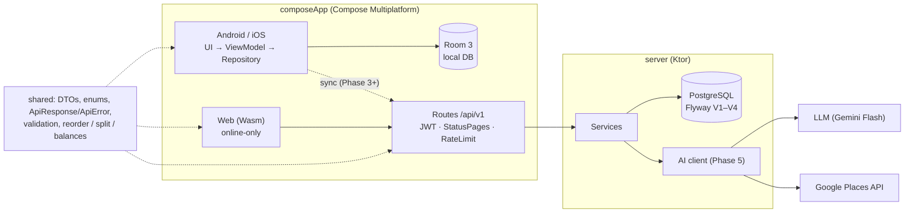

# TRD — RANSEL

Oct 13, 2026 · @SEN

## Technical summary

One Kotlin codebase: a Compose Multiplatform app (Android, iOS, Web Wasm), a Ktor server, and a `shared` module for data models, validation, and the API contract. On Android and iOS, data is stored locally first (offline-first) and then synced to PostgreSQL. The web app is online-only: it has no local database, calls the API directly, and requires signing in. AI recommendations are computed on the server; the client never holds an API key.

Principles:

- Every phase ships a usable app; Phase 1 runs without a server.
- If a class travels over the network or its rules must match on app and server, it lives in `shared`.
- Money is always a `Long` in the smallest unit (`amountMinor`), never a `Double`.
- IDs are created on the client (UUID), and every table has `created_at`, `updated_at`, `deleted_at` for sync.
- Product requirements and business rules live in PRD — RANSEL; this document explains how to build them.

## Architecture

The Android and iOS apps read from and write to a local Room database; sync to the server runs in the background over HTTPS. The web app reads and writes through the API only, because it is always loaded from the server anyway. The server holds shared data in PostgreSQL and is the only party that calls the LLM and the Places API.



The `shared` module is used by both app and server, so models, validation, and calculations (reorder, split bill, balances) are identical on both sides.

## Tech stack and modules

| Layer | Choice | Notes |
| --- | --- | --- |
| UI | Compose Multiplatform | Android, iOS, Web (Wasm) |
| Navigation | Navigation Compose (multiplatform) |  |
| State | ViewModel + StateFlow | Lifecycle ViewModel is multiplatform |
| DI | Koin |  |
| Local database | Room 3 (androidx.room3), Android and iOS only | Stable KMP support and familiar from Android; the web app needs no local database |
| Networking | Ktor Client + kotlinx.serialization | Engine per platform via expect/actual |
| Dates and money | kotlinx-datetime, `Long` in the smallest unit | M3 DatePicker uses UTC millis |
| Resources | Compose Resources | Strings in `values/` (EN) and `values-in/` (ID), illustrations as WebP |
| Backend | Ktor Server | Routing, Authentication (JWT), StatusPages, RateLimit |
| Server database | PostgreSQL + Exposed | Flyway migrations |
| Infrastructure | Docker Compose | Local Postgres in development, server image for deploy |
| AI (Phase 5) | LLM (Gemini Flash, Gemini Developer API) + Google Places API | Called from the server only; model id from `LLM_MODEL` |

Repository layout: one Gradle project with three modules, generated from the kmp.jetbrains.com template with the Server option.

```text
ransel/
├── composeApp/   UI for every platform (commonMain + androidMain/iosMain/wasmJsMain)
├── shared/       @Serializable models, ApiResponse/ApiError, validation, domain logic
└── server/       Ktor: routes, services, repositories (Exposed), Flyway migrations
```

## Data model

Every table uses a client-generated UUID plus `created_at`, `updated_at`, `deleted_at` (soft delete). The migrations live in `db/migration` as V1–V4, one per phase, and already contain every table and column below. Changes from the design discussion were folded into them directly, because no database has been created yet. After the first deploy, existing migrations are never edited again; changes go into new files (V5 onwards).

| Table | Main columns | Migration (phase) |
| --- | --- | --- |
| trips | id, owner\_id, title, destination, start\_date, end\_date, base\_currency, budget\_minor, cover\_url | V1 (1–2) |
| itinerary\_items | id, trip\_id, day\_date (null = unscheduled), start\_time, end\_time, title, category, place\_name, place\_id, lat, lng, duration\_min (AI estimate), notes, booking\_url, source (MANUAL/AI), sort\_order DOUBLE | V1 (1–2) |
| packing\_items | id, trip\_id, category, name, quantity, is\_packed, sort\_order | V1 (1–2) |
| packing\_templates | id, owner\_id (null = built-in), name, items JSONB; shared\_trip\_id added in V3 | V1, V3 |
| expenses | id, trip\_id, amount\_minor, currency, fx\_rate\_to\_base, category, payment\_method, note, spent\_at, paid\_by\_user\_id | V1 (1–2) |
| users | id, display\_name; email, password\_hash, default\_currency added in V2 | V1, V2 |
| refresh\_tokens | id, user\_id, token\_hash, device\_name, expires\_at, revoked\_at | V2 (3) |
| password\_reset\_tokens | id, user\_id, token\_hash, expires\_at, used\_at | V2 (3) |
| trip\_members | trip\_id, user\_id, role (OWNER/EDITOR/VIEWER), joined\_at | V3 (4) |
| trip\_invites | code, trip\_id, created\_by, role, max\_uses, used\_count, expires\_at, revoked\_at | V3 (4) |
| expense\_splits | expense\_id, user\_id, share\_minor | V3 (4) |
| settlements | id, trip\_id, from\_user\_id, to\_user\_id, amount\_minor, settled\_at | V3 (4) |
| recommendation\_cache | query\_hash, destination, response JSONB, model, hit\_count, expires\_at | V4 (5) |
| recommendation\_feedback | trip\_id, user\_id, place\_id, place\_name, category, action (LIKE/SKIP) | V4 (5) |
| credit\_wallets, credit\_daily, credit\_ledger | wallet balance per user (created with the signup grant), free credits used per WIB day, append-only ledger (SPEND/SIGNUP\_GRANT/VOUCHER/TOPUP/...) | V8 (5) |
| credit\_vouchers, credit\_voucher\_redemptions | top-up codes, one redemption per user per code | V8 (5) |
| devices | push token per phone (platform, locale, disabled\_at) | V10 |
| notifications | inbox: type, params, trip, dedupe\_key (unique per user), read\_at, push\_state (outbox) | V10 |
| notification\_settings | three switches per user (missing row = all on) | V10 |
| admin\_audit\_log; users.disabled\_at; credit\_ledger.note | append-only log of admin actions; account deactivated by an admin; the admin's reason for an ADJUSTMENT (which may now be negative) | V12 (6) |
| email\_verification\_tokens; users.email\_verified\_at | sign-up email link (hash only, 24 h, newest link only); when the email was verified (existing accounts backfilled) | V13 (3) |
| app\_settings | admin overrides of config values (key, JSON value, updated\_by) | planned (6) |
| ai\_search\_log, error\_counts | one row per Explore search (parameters, source, latency, credits, estimated cost); errors per hour, code and route | planned (6) |

Enums:

- `category` on itinerary\_items and expenses uses one shared enum: ATTRACTION, FOOD, TRANSPORT, LODGING, SHOPPING, OTHER. Itinerary labels: Wisata/Explore, Kuliner/Eat, Perjalanan/Travel, Menginap/Stay, Belanja/Shop, Lainnya/Other. Expense labels: Aktivitas/Activities, Makan/Food, Transport, Penginapan/Lodging, Belanja/Shopping, Lainnya/Other. Both use the same color per value.
- AI core interests: NATURE, FOOD, CULTURE, SHOPPING, ADVENTURE, NIGHTLIFE, PHOTO, RELAX (destination interests are free strings from the AI). Price level: LOW, MEDIUM, HIGH. Style: SANTAI, PADAT. Details: `docs/specs/AI-Recommendation-Spec.md`, which wins over this section for Explore.
- Expense `payment_method` (the "Bayar pakai" field): CASH, DEBIT\_CARD, CREDIT\_CARD, TRANSFER, E\_WALLET, OTHER; default CASH.

Notes:

- `sort_order` is fractional so moving one item only changes one row (a value between its neighbours); an itinerary reorder also rewrites the times in the affected range.
- The currency is stored per expense together with fx\_rate\_to\_base (the rate when the expense was recorded, so old totals stay fixed); conversion to `base_currency` happens when the summary is shown.
- In Phase 1, `owner_id` and `paid_by_user_id` hold a fixed local ID, replaced by the real user ID on sign-in.

## API

Every endpoint sits under `/api/v1`. From Phase 3, every endpoint except auth requires `Authorization: Bearer <access_token>`. Rows marked ★ were added during the design discussion.

| Method | Path | Purpose | Phase |
| --- | --- | --- | --- |
| GET | /health | Server check | 2 |
| GET, POST | /trips | List / create trips | 2 |
| GET, PUT, DELETE | /trips/{id} | Detail + summary / update / delete (soft) | 2 |
| GET, POST | /trips/{id}/itinerary | List / add activities | 2 |
| PUT, DELETE | /trips/{id}/itinerary/{itemId} | Update (including scheduling: set day\_date + times) / delete | 2 |
| PUT ★ | /trips/{id}/days/{date}/order | Save the new order + times of one day: items \[{id, sortOrder, startTime, endTime}\] | 2 |
| GET, POST | /trips/{id}/packing | List / add items | 2 |
| PATCH | /trips/{id}/packing/{itemId} | Tick / update an item | 2 |
| DELETE ★ | /trips/{id}/packing/{itemId} | Delete an item | 2 |
| POST ★ | /trips/{id}/packing/uncheck-all | Uncheck all items | 2 |
| GET, POST | /trips/{id}/expenses | List / record (Phase 4: paidBy + splits) | 2 |
| GET | /trips/{id}/expenses/summary | Totals per category and per day | 2 |
| PUT, DELETE ★ | /trips/{id}/expenses/{expenseId} | Edit (splits replaced whole) / delete an expense | 2 |
| POST | /auth/register, /auth/login, /auth/refresh | Account and tokens | 3 |
| POST ★ | /auth/logout | Sign out this device (revokes its refresh token) | 3 |
| POST ★ | /auth/password/forgot, /auth/password/reset | Forgot password | 3 |
| POST ★ | /auth/email/verify (public), /auth/email/resend (bearer) | Verify the email after sign-up; send a new link | 3 |
| GET, PATCH ★ | /me | Profile, default currency | 3 |
| GET, POST | /sync | Pull changes since a timestamp / push a local batch | 3 |
| POST | /trips/{id}/invites | Create an invite code (role, maxUses, expiresAt) | 4 |
| GET ★ | /trips/{id}/invites | List invites with usage, for the Members screen | 4 |
| DELETE ★ | /trips/{id}/invites/{code} | Revoke an invite | 4 |
| GET ★ | /invites/{code} | Trip preview for the Join trip screen | 4 |
| POST | /invites/{code}/accept | Join the trip | 4 |
| GET | /trips/{id}/members | List members | 4 |
| PATCH, DELETE ★ | /trips/{id}/members/{userId} | Change role / remove member | 4 |
| POST ★ | /trips/{id}/leave, /trips/{id}/transfer-ownership | Leave the trip / transfer ownership | 4 |
| GET | /trips/{id}/balances | Balance per person + fewest transfers | 4 |
| POST ★ | /trips/{id}/settlements | Mark as settled | 4 |
| GET ★ | /trips/{id}/settlements | List settlements | 4 |
| GET, POST ★ | /packing-templates | Built-in + user templates / save a template | 4 |
| POST ★ | /trips/{id}/packing/apply-template | Use a template (option to skip items already there) | 4 |
| POST, DELETE ★ | /devices | Register / refresh this phone's push token; remove it on sign-out | 5 |
| GET ★ | /notifications | Inbox page + unread count | 5 |
| POST ★ | /notifications/read | Mark some or all read | 5 |
| GET, PATCH ★ | /notification-settings | The three switches | 5 |
| GET ★ | /credits | Balance, free credits left today, cost per action | 5 |
| GET ★ | /credits/ledger | Credit history, newest first | 5 |
| GET ★ | /credits/packages | Top-up packs and prices (`purchasable` is false until a payment provider exists) | 5 |
| POST ★ | /credits/redeem | Redeem a voucher code | 5 |
| GET | /explore/suggestions | Destination interests + suggested price level for the Explore form (costs no credits) | 5 |
| POST | /recommendations | AI recommendations from preferences | 5 |
| POST ★ | /recommendations/feedback | LIKE / SKIP per place | 5 |
| DELETE ★ | /recommendations/feedback/{tripId}/{placeId} | Undo the last swipe | 5 |
| GET ★ | /trips/{id}/rounds | Open and recent voting rounds (banner, trip-list dot); any member | 5 |
| GET ★ | /trips/{id}/rounds/{roundId} | One round: cards, my votes; OWNER also tally with names and voters, members counts after closing | 5 |
| PUT ★ | /trips/{id}/rounds/{roundId}/votes/{placeId} | Vote LIKE / SKIP (idempotent); DELETE = undo; 409 `VOTING_CLOSED` | 5 |
| POST ★ | /trips/{id}/rounds/{roundId}/decide | OWNER picks the places that enter the itinerary and closes the round | 5 |
| GET | /places/photo/{placeId}?exp=&sig= | Signed place-photo proxy (no bearer; 404 if no photo) | 5 |
| GET | /places/{placeId}/detail | Saved detail text of a place (about, tips, hours estimate) to open it again from the itinerary; rebuilt by one small LLM call when expired | 5 |
| GET, POST ★ | /admin/... | Admin app (Karung): users, credit adjustments, audit log, overview, Explore AI, system, settings, content. Admin token only; full list in `docs/specs/admin-spec.md` "API" | 6 |
| GET ★ | /content?version= | Published remote content for the apps (apps call it in a later step) | 6 |

The exact request and response classes for every row are in the `shared` module (`api/ApiRoutes.kt`, `dto/`), which is the contract between the app and the server.

**Response format.** Success or failure is read from the HTTP status code. Success: `{"data": …}` (lists add `meta` for paging); failure: `{"error": {"code", "message", "details"}}`. 201 for create, 204 for delete, 400/422 for validation, 401 for tokens, 403 for no permission, 404, 409 for conflicts, 429 for quota, 500 without a stack trace.

**Error codes** are fixed constants for app logic and are shown small on the state screens: `NETWORK_TIMEOUT` (client), `INTERNAL_ERROR`, `TOKEN_EXPIRED`, `TRIP_NOT_FOUND`, `INVITE_EXPIRED`, `INVITE_REVOKED`, `INVITE_FULL`, `AI_UNAVAILABLE`, `RATE_LIMITED`, `SPLIT_TOTAL_MISMATCH`, `OWNER_CANNOT_LEAVE`, for voting `ROUND_NOT_FOUND`, `VOTING_CLOSED`, `ROUND_ALREADY_DECIDED`, `ROUND_LIMIT`, and `ACCOUNT_DISABLED` (403, an admin deactivated the account).

Conventions: camelCase fields, ISO 8601 dates, UTC times, money in the smallest unit. The `ApiResponse<T>` and `ApiError` wrappers live in `shared`; the server wraps responses with `call.respondData(...)` and StatusPages; the client maps them to `sealed interface ApiResult<T> { Success, Failure }`.

## Offline-first sync

On Android and iOS, the local database is the source of truth for the UI; the server is only the sync target. Conflicts are resolved last-write-wins per row by `updated_at`.

1. Every local write saves the row with `updated_at = now` and marks it `pending` (used by the UI for the "waiting to sync" marker and the change count on the Session expired screen).
2. When online, a worker sends every `pending` row in one batch with `POST /sync`.
3. The server applies each row if its `updated_at` is newer than the stored one, checks access per trip, and returns accepted and rejected rows with reasons.
4. The client pulls other changes with `GET /sync?since=<lastSyncAt>`, overwrites older local rows, and stores `lastSyncAt` from the server clock.
5. The UI shows the snackbar "Back online · n changes sent".

Supporting rules:

- Deletes are always soft (`deleted_at`) so they sync too; permanent cleanup runs periodically on the server.
- An itinerary reorder writes several rows at once (order + times); the batch is applied in one transaction so a day is never half-sorted.
- If the refresh token expires while changes are pending → Session expired screen; the changes stay local until the user signs in again.
- Data from "Use without an account for now" uses a fixed local ID; on the first sign-in, `owner_id` and `paid_by_user_id` are replaced with the user ID and synced.
- Features that need the server (Explore AI, invites, members) show the connection error state when offline.

## Domain logic

Everything in this section lives in `shared` so the app (offline) and the server compute the same thing.

**Itinerary reorder.** Durations are kept; the affected range is packed from the earliest start time in that range.

```kotlin
data class Slot(val id: String, val start: LocalTime, val end: LocalTime)

fun reorder(items: List<Slot>, from: Int, to: Int): List<Slot> {
    if (from == to) return items
    val lo = minOf(from, to); val hi = maxOf(from, to)
    val moved = items.toMutableList().apply { add(to, removeAt(from)) }
    var cursor = items[lo].start.min()
    for (i in lo..hi) {
        val duration = moved[i].end.min() - moved[i].start.min()
        moved[i] = moved[i].copy(start = cursor.toTime(), end = (cursor + duration).toTime())
        cursor += duration
    }
    return moved
}
private fun LocalTime.min() = hour * 60 + minute
private fun Int.toTime() = LocalTime(this / 60, this % 60)
```

The result is sent to `PUT /trips/{id}/days/{date}/order`. Undo simply resends the list as it was before the reorder.

**Schedule a place.** `start` = the `end` of the day's last activity, or 09:00 if the day is empty; `end` = `start` + `duration_min` from the AI; `sort_order` = last + 1. The user can change the time before saving.

**Split bill.** Split equally: `share = amount / n`; the rounding remainder (in the smallest unit) goes to the payer so the total always matches. Set amounts: the server rejects with `SPLIT_TOTAL_MISMATCH` if the shares do not add up to the amount.

**Balances and fewest transfers.** `balance(user) = Σ paid − Σ share + Σ settlements paid − Σ settlements received`. Fewest transfers are computed greedily: pair the largest debtor with the largest creditor and repeat until everything is zero. For small groups the result is close enough to the minimum.

**Invites.** Code = a prefix from the trip name + 4 random characters without look-alike letters (e.g. `BALI-7K2Q`). Accept checks in order: revoked → `INVITE_REVOKED`, past `expires_at` → `INVITE_EXPIRED`, `used_count ≥ max_uses` → `INVITE_FULL`; if it passes, create `trip_members` and increment `used_count` in one transaction.

**Authorization per trip.** Every trip route calls one function `requireRole(tripId, minRole)`: VIEWER to read, EDITOR to change content, OWNER for members, invites, and deleting the trip. The owner cannot `leave` before `transfer-ownership` (`OWNER_CANNOT_LEAVE`). Removing a member does not delete their `expenses` or `expense_splits`.

## Notifications

An event writes the inbox row **inside the transaction that caused it** (invite accepted, role change, expense or settlement created through REST or through `/sync`), so a rolled-back change leaves nothing behind. A background loop (every 5 s) sends the pushes of rows still `PENDING` (an outbox): it renders the text per device language (`PushText`), calls FCM HTTP v1 (`FcmPushSender`, no Firebase SDK: a signed JWT is exchanged for an access token), disables a device on `UNREGISTERED`, retries temporary failures three times and then gives up (the inbox row stays). `UNIQUE (user_id, dedupe_key)` makes every event idempotent: expenses use `expense:<id>` and only a **new** expense notifies, never an edit or a sync retry. Settings are checked when the row is written. `ReminderScheduler` ticks every minute: packing at 18:00 WIB the day before the trip starts (if items are unpacked), activities in the 30 minutes before their start (WIB; trips have no timezone yet); the windows are "from now until X", so a missed tick still fires once. Read notifications older than 90 days and long-disabled devices are purged hourly. Without `FCM_*` env the sender only logs; the inbox is unaffected.

## Auth and security

- **Passwords** are hashed with bcrypt. Minimum rules: 8 characters, at least one letter and one number; validated in `shared` so the Sign up screen and the server use the same rule.
- **Tokens.** A short-lived JWT access token; a random refresh token stored as a hash in `refresh_tokens` and rotated on every use. Sign out revokes that device's refresh token.
- **Client storage.** Tokens are kept in the platform's secure storage (Keystore/Keychain); on web, an httpOnly cookie or storage with accepted risk.
- **Forgot password.** `forgot` always answers 204 (it never reveals whether the email exists) and sends a link with a single-use token valid for 30 minutes. `reset` replaces the hash, marks the token used, and revokes every refresh token of the user so other devices are signed out.
- **Email verification.** Register answers 201 with a session as before and emails a link (`APP_BASE_URL/verify-email?token=`, single use, 24 hours; a resend voids older links). Until the link is opened the account works except Explore and vouchers (403 `EMAIL_NOT_VERIFIED`) and the wallet gets no signup grant; verifying grants it (idempotent, ledger key `signup:<userId>`). Accounts that existed before V13 and seed accounts count as verified.
- **Session expired.** When refresh fails (`TOKEN_EXPIRED`), the app shows the Session expired screen; local data stays.
- **Authorization** is always checked on the server per trip (`requireRole`), never only in the UI.
- **Admins** are the accounts whose email is in `ADMIN_EMAILS` (server env). Every `/admin` request looks the account up and checks its email against the list (no token claim), and the account must be active. Admin actions go to `admin_audit_log`. Details: `docs/specs/admin-spec.md`.
- **Email.** Verification and password reset emails are sent from `no-reply@mietek.tech` over SMTP (`SMTP_HOST`, `SMTP_PORT`, `SMTP_USERNAME`, `SMTP_PASSWORD`, `EMAIL_FROM`), so any provider with an SMTP relay works; the provider itself is still open. Without `SMTP_HOST` the server logs the link (development) or logs that nothing was sent (production).
- **Secrets.** The LLM and Places API keys live only on the server (environment variables), never in the client or the repository.

## AI feature (Explore)

The server receives the preferences, asks the LLM for candidate places as JSON, validates every place against the Places API, then sends 10–15 cards to the app.

1. The app sends `POST /recommendations` with `tripId` (destination and dates come from the trip), optional focus area, price level (LOW/MEDIUM/HIGH, relative to local prices), core and destination interests, style (SANTAI/PADAT), notes, and the `placeId`s already liked or skipped. The form is fed by `GET /explore/suggestions` (destination interests cached per destination + month for 30 days, no quota).
2. The server checks the user can pay (402 `INSUFFICIENT_CREDITS` when not, before any LLM call), then checks `recommendation_cache` with a key hashed from destination + focus area + month + interests + price level + style.
3. Cache miss: call the LLM with a prompt asking for JSON that matches the schema; parse into a `@Serializable` data class in `shared`; on a parse failure retry once → `AI_UNAVAILABLE`.
4. Validate every name with Places Text Search (IDs Only, free); places that are not found are dropped. Details (photo, rating) are fetched lazily for the top 2–3 cards only.
5. An empty result after validation → an empty response; the app shows the "No good match yet" state naming the preferences that caused it.
6. Swipe right creates an `itinerary_items` row with `day_date = null`, `source = AI`, and `duration_min` from the AI; swipe left records SKIP in `recommendation_feedback` so the place does not come back for that trip.
7. When 3 cards are left, the app requests the next batch in the background with the latest feedback.

The swipe session (remaining cards, position, number saved) is stored locally in the app for the Continue card; it is discarded when all cards are seen or the user searches again.

**Cost** (prices as of October 2026, subject to change; the LLM was DeepSeek V4.1 Flash at about $0.003 per request of 15 places when this was written, now Gemini Flash: check the current Gemini price). The Places API is what needs watching: Text Search IDs Only is free, Place Details Essentials $5 per 1,000 (10,000 free per month); Pro $17 and Enterprise $20 per 1,000 (1,000 free), where `rating` and `priceLevel` live: the app never asks for them (no rating on cards; the price filter uses the LLM cost estimate). Strategy: validate with IDs Only, fetch details lazily, keep the field mask minimal, cache `placeId`s, and set a Google Cloud budget alert from day one.

**Credits** (replace the fixed 10 searches a day): each user has a wallet (30 credits, created on first use, so existing users get it too) and a free daily allowance (3 credits, resets at 00:00 WIB, no carry-over). A charge takes the free allowance first, then the wallet (`planCreditSpend` in `shared`). A new search costs 3, the next batch (`newSearch=false`) 1, suggestions and cached place detail 0; the price of a place-detail rebuild is a config key, 0 for now. The numbers come from server config (`CREDIT_*`) as defaults; an admin can override each one in Karung (stored in `app_settings`, see `docs/specs/admin-spec.md` "Credit settings"), and the effective values reach the app through `GET /credits`. An admin can also add or subtract wallet credits for one user (`ADJUSTMENT` ledger rows, either sign, never below 0). The server checks before the LLM call and charges after the search succeeded, so a failed search costs nothing; a cache hit still costs credits. Every wallet change locks the user's wallet row (`SELECT ... FOR UPDATE`) and writes a `credit_ledger` row, so parallel searches never overdraw. Without credits the server returns 402 `INSUFFICIENT_CREDITS` (`details`: cost, available, resetsAt) and the app shows the out-of-credits screen. Top-up in stage 1 is a voucher code (`POST /credits/redeem`, made with `deploy/create-voucher.sh`); a payment provider later calls the same `addCredits` with an idempotency key. The recommendation endpoints sit behind JWT auth like the rest of the API (401 without a token); guests never call them, because the Explore tab shows a sign-in screen until the user has an account.

## Client

**Structure.** Per feature: `ui/` (Composables + ViewModel with `StateFlow<UiState>`), `data/` (repository that reads the local database and queues sync), `domain/` from `shared`. ViewModels never touch status codes; they receive `ApiResult`.

**Navigation.** A bottom navigation with four tabs: Home, Trips, Explore, Account. Trip detail uses the tabs Itinerary / Packing / Expenses, and every trip screen has a members button (`group_add`) in its header. Swipe, forms, and full-screen states open above the tabs. The Explore tab always goes to the Explore screen; an unfinished session is marked with a dot on the tab icon.

**Built-in Material 3 components.** `DatePickerDialog` (UTC millis from `kotlinx-datetime`), a full-screen `DateRangePicker` for trip dates, a 24-hour `TimePicker` inside an `AlertDialog`, `ModalBottomSheet` for sheets, and `AlertDialog` for confirmations. All are themed with IRIS tokens through `MaterialTheme`.

**Drag and drop.** In `commonMain`: `Modifier.pointerInput` + `detectDragGesturesAfterLongPress`; the dragged item gets a 2 dp `primary` border (no rotation). Explore swipe cards use `Animatable` for the horizontal offset (no rotation either) and are thrown off screen past 40% of the card width; ✕ / ♥ / Undo buttons and arrow keys for web.

**Resources.**

- Strings in Compose Resources: `values/strings.xml` (EN) and `values-in/strings.xml` (ID). Category labels come in two sets over the same enum: itinerary (Wisata/Explore, Kuliner/Eat, Perjalanan/Travel, Menginap/Stay, Belanja/Shop, Lainnya/Other) and expenses (Aktivitas/Activities, Makan/Food, Transport, Penginapan/Lodging, Belanja/Shopping, Lainnya/Other).
- The capybara illustrations come from IRIS (1024 px PNG), are exported to WebP at 2× the display size (e.g. 440 px for 220 dp), and are loaded with `painterResource`; `contentDescription = null` because they are decorative.

**Theme.** `IrisTheme` with light and dark schemes from the IRIS tokens; the Follow system / Light / Dark choice is stored in local preferences.

**Web PWA.** The web app is installable: `wasmJsMain/resources` holds `manifest.webmanifest` (standalone, theme `primary` #008808, icons from the Android launcher art) and `sw.js`. The service worker caches the app shell only, never API data (the API is on another host and is not intercepted): `.wasm` and fonts cache-first (content-hashed or unchanging), pages, `composeApp.js`, the manifest and other Compose resources network-first with the cache as fallback; every navigation, including `/j/<code>`, falls back to `index.html`. The cache is named `ransel-shell-<build id>`; `wasmJsBrowserDistribution` stamps the id (CI: `GITHUB_SHA`), and the new worker deletes older caches on activation. The worker registers only on `ransel.mietek.tech` (or a local URL with `?sw`), so the dev server is never cached. No install button or update banner in the app: the browser's own install UI is used.

**Layout.** The 390 dp phone is the reference; widths ≥ 1240 dp (web) use a 96 dp navigation rail and a 360 dp side panel. Long forms use `Column` + `verticalScroll` so buttons are never squeezed.

## Testing, deploy, and observability

- **Unit tests in `shared`** for the logic most likely to go wrong: `reorder` (including the 10:00–11:25 → 10:00–10:35 example), scheduling a place, equal split with the rounding remainder, balances and fewest transfers, password validation, the invite check order.
- **Server** tested with Ktor `testApplication` and Postgres in Docker (Testcontainers or Compose); `.http` files for manual endpoint tests.
- **Sync** tested with scenarios: write offline on a phone → go online → appears on web; two devices change the same row → the newer `updated_at` wins.
- **Client:** Compose UI tests for the main flows (create trip, add activity, tick packing, record expense) on Android; all three targets built in CI.
- **Deploy:** a Docker image for the server + PostgreSQL in Docker Compose on the VPS behind Caddy (HTTPS); daily pg\_dump backup copied off the VPS; Flyway runs at startup; environment variables for the JWT secret and the LLM and Places keys.
- **Observability:** structured logs per request with `error.code`; metrics for LLM/Places calls, cache hit rate, and 402 out-of-credits responses; a Google Cloud budget alert.

## Open work

- [x] `POST /trips/{id}/settlements` endpoint (the `settlements` table is in V3); `balances` accounts for settlements.
- [x] Seed the built-in packing templates (beach, city trip, mountain hike). `owner_id` is already nullable (V1) and `shared_trip_id` exists (V3).
- [ ] Send the password reset email (email provider not chosen yet); `password_reset_tokens` is in V2.
- [x] `transfer-ownership` and `leave` endpoints with the `OWNER_CANNOT_LEAVE` rule.
- [x] `PUT /trips/{id}/days/{date}/order` replaces `PUT /trips/{id}/itinerary/order` (it saves times too).
